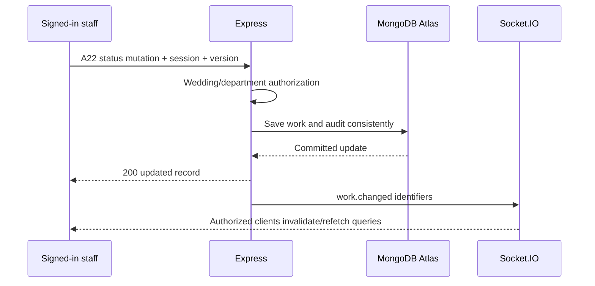
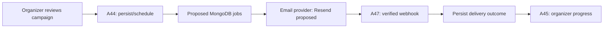

# Make My Marriage — API Design

Version 1.0 · 15 October 2026 · Status: Discussion draft

This document records the API draft discussed in chat. It contains **59 proposed REST endpoints**, counting each HTTP method and path separately. No APIs have been implemented. Endpoint names, payloads, success codes, and unresolved policies remain review proposals.

References: [PRD v1.3](./Make-My-Marriage-PRD.md) and [System Design v1.1](./Make-My-Marriage-System-Design.md).

## 1. Scope and technology

TypeScript, Vite/React, React Router, React Hook Form/Zod, TanStack Query, Node.js/Express, MongoDB Atlas/Mongoose, Express sessions, Socket.IO, Cloudflare R2, Google Places, Google Cloud Translation, YouTube Live, and AWS hosting.

Resend is the proposed email provider. MongoDB-backed jobs and an in-process runner are proposals. Exact session-store library, R2 bucket layout, and AWS deployment services have not been finalized.

Guest invitations are email-based. Guests do not register or RSVP. Provider discovery/contact does not create bookings. There is no online payment processing, seat locking, transport/accommodation management, or custom video streaming.

## 2. Base paths and access

Base prefix: `/api/v1`. Every endpoint in the tables is relative to that prefix. `:wid` means wedding ID; other IDs refer to records within that wedding unless explicitly public.

| API group | Meaning |
|---|---|
| /auth/* | Account and session operations |
| /app/* | Signed-in application; wedding membership/role checks where relevant |
| /team-invites/:token | Token-limited invite preview; acceptance requires login |
| /providers/* | Directory discovery; public versus signed-in access is pending |
| /public/* | Guest-facing published content and scoped invitation reads |
| /uploads/* | Upload token/permission required; no guest login |
| /webhooks/* | External provider signature required; no browser session |

Browser routes `/app/*`, `/w/*`, and `/upload/*` are React pages, not REST endpoint paths. Express serves the React production build and API under one application origin; Vite proxies API/socket requests during development.

### Authorization sequence

Session → user → active wedding membership → role → department/resource scope → allowed response fields.

- Creator/organizer permissions are scoped to a wedding, not a global `user.role` alone.
- Managers can manage workers within assigned departments; they cannot grant organizer privileges.
- Workers update permitted department work and see safe cross-department summaries.
- Finances, private guest records, and photo approval are organizer-only.
- Adding a vendor contact or public provider profile never grants wedding membership.
- Guest invitation, team invitation, and upload tokens are different capabilities and cannot be exchanged.

Role codes below: **S** signed-in user; **O** authorized organizer; **D** staff with matching department scope; **M** active wedding member; **T** valid token; **P** verified provider webhook. Creator-only management of other organizers is a pending policy.

## 3. Request, response, and error conventions

Requests use JSON except the direct R2 file PUT, which is outside these Express REST endpoints. Browser session cookies accompany same-origin requests. Cookie-authenticated mutations use CSRF/origin protection. Webhooks use their own signature checks against the unmodified payload.

Successful response:

```json
{
  "data": { "id": "record-id" },
  "meta": { "page": 1, "limit": 20, "hasMore": false }
}
```

`meta` appears for lists only. `204 No Content` responses have no JSON body. Proposed V1 pagination uses page/limit with a server-enforced limit; final limits are configuration decisions.

Error response:

```json
{
  "error": {
    "code": "VALIDATION_ERROR",
    "message": "Some fields are invalid.",
    "details": { "amountPaise": "Must be a valid integer amount." }
  },
  "requestId": "request-id"
}
```

| HTTP status | Meaning |
|---|---|
| 200 | Read/update/action succeeded |
| 201 | Record created |
| 202 | Work persisted and scheduled; not yet delivered/published |
| 204 | Successful action with no response body |
| 401 | Login missing or expired for a private request |
| 403 | Authenticated user lacks permission |
| 404 | Record/link unavailable; use consistent policy for inaccessible private IDs |
| 409 | Duplicate/conflicting record or stale expectedVersion |
| 422 | Invalid fields, status transition, schedule, or referenced resource |
| 429 | Rate/quota limit |
| 503 | Required backend dependency unavailable |

Store/send money in integer paise and timestamps in ISO UTC format. Keep wedding timezone separately. Allowed work statuses: `todo`, `in_progress`, `done`. Client cannot set actorId, protected weddingId, approval status, or granted roles through unrelated update payloads.

On conflict-prone edits, proposed `expectedVersion` must match current record version. For retryable creates/send actions, a proposed `Idempotency-Key` prevents repeated requests creating new logical work. This does not guarantee exactly-once external email delivery.

## 4. Endpoint count

| Module | IDs | Count |
|---|---|---:|
| Accounts and team | A01–A10 | 10 |
| Weddings, functions, planning | A11–A23 | 13 |
| Attention and finance | A24–A32 | 9 |
| Provider directory | A33–A37 | 5 |
| Guests and email | A38–A47 | 10 |
| Public pages and photos | A48–A59 | 12 |
| Total | | **59** |

Socket.IO events, Google/YouTube/R2 external requests, and internal job functions are not included in this REST count. This is the current inventory, not a claim that every frontend helper endpoint has been finalized.

## 5. Accounts and team — 10 endpoints

| ID | Method | Path | Access | Responsibility | Success |
|---|---|---|---|---|---|
| A01 | POST | /auth/signup | Public | Create account without email verification | 201 |
| A02 | POST | /auth/login | Public | Verify credentials, regenerate/persist session | 200 |
| A03 | GET | /auth/me | S | Current identity and membership summary | 200 |
| A04 | POST | /auth/logout | S | Destroy session, clear cookie, disconnect session sockets | 204 |
| A05 | POST | /app/weddings/:wid/team-invites | O or permitted manager | Generate scoped collaborator invitation | 201 |
| A06 | GET | /team-invites/:token | T | Limited invitation preview | 200 |
| A07 | POST | /app/team-invites/:token/accept | S + T | Consume invitation and grant membership | 200 |
| A08 | GET | /app/weddings/:wid/members | M | Permitted team member/role listing | 200 |
| A09 | PATCH | /app/weddings/:wid/members/:id | Hierarchy policy | Change permitted role/department scope | 200 |
| A10 | DELETE | /app/weddings/:wid/members/:id | Hierarchy policy | Revoke membership without deleting historical activity | 204 |

Payload/response details:

- **A01:** input displayName, email, password. Return safe user summary, never passwordHash. Automatic login after signup is proposed; if selected, persist session before returning authenticated success. Duplicate normalized email → 409. No OTP/verification gate.
- **A02:** input email/password. Return safe user summary and Set-Cookie after session save. Invalid credentials receive a generic error. Cookie contains session identity, not a permanent role snapshot.
- **A03:** return user and active membership scope. An account without a wedding can still use setup/provider screens. No budget/guest data returned here.
- **A05:** role, departmentIds, optional deliveryEmail. Server verifies inviter can grant exactly that scope. Generate token hash, expiry, unused state. Original link is returned/emailed through a reviewed secure payload path; no raw token logging.
- **A06:** preview wedding label, role, and required sign-in action, not private planning data.
- **A07:** invitation supplies role/scope; request cannot choose a new role. Atomically consume token and grant membership. Same-account repeat can return existing outcome; another account cannot reuse it.
- **A08–A10:** staff visibility and management differ. Managers act only on workers in their scope. Removal must revoke API and Socket.IO access. Creator transfer/removal policy remains open.

## 6. Wedding, functions, and planning — 13 endpoints

| ID | Method | Path | Access | Responsibility | Success |
|---|---|---|---|---|---|
| A11 | POST | /app/weddings | S | Create wedding and editable checklist | 201 |
| A12 | GET | /app/weddings/:wid | M | Role-appropriate private wedding details | 200 |
| A13 | PATCH | /app/weddings/:wid | O | Edit wedding settings and couple information | 200 |
| A14 | POST | /app/weddings/:wid/publish | O | Publish approved generic guest information | 200 |
| A15 | GET | /app/weddings/:wid/dashboard | M | Planning/functions/attention summary | 200 |
| A16 | POST | /app/weddings/:wid/functions | O | Create function/schedule/venue | 201 |
| A17 | PATCH | /app/weddings/:wid/functions/:id | O | Edit function, venue, eligible livestream settings | 200 |
| A18 | DELETE | /app/weddings/:wid/functions/:id | O | Remove/archive function consistently | 204 |
| A19 | POST | /app/weddings/:wid/departments | O | Add family-managed or vendor department | 201 |
| A20 | PATCH | /app/weddings/:wid/departments/:id | O or scoped manager | Update allowed contact/planning details | 200 |
| A21 | POST | /app/weddings/:wid/departments/:id/work-items | O or scoped manager | Add department checklist work | 201 |
| A22 | PATCH | /app/weddings/:wid/work-items/:id | O or D | Update status, note, or allowed deadline fields | 200 |
| A23 | GET | /app/weddings/:wid/work-items/:id/history | O or permitted D | Read scoped progress history | 200 |

Payload/response details:

- **A11:** couple names, mainWeddingDate, timezone, optional approved contact/photo references. Server assigns creator and organizer membership; family member can manage without hiring a planner. Seed checklist retry-safely. Active-versus-lifetime workspace limit remains unresolved.
- **A12–A14:** explicit editable/published fields; private work notes, budget, and guest list cannot be published through this payload. Version-check conflicting edits. Main date changes reschedule unsent reminder work under the eventual policy.
- **A15:** department summaries, relevant work, next functions, and attention reasons. Finance is fetched separately through A27 to reduce accidental disclosure. Workers receive own details and safe cross-department summary.
- **A16–A18:** title, startsAt, endsAt, venue label/allowed coordinates/place reference, entrance/landmarks, optional YouTube config. Enforce no overlapping functions, including concurrent schedule edits. Removal must resolve invitation references without widening guest access.
- **A19–A20:** department name, family/outside_vendor/platform_provider source, optional providerId and role/phone contact. Outside vendor addition creates no account; provider contact creates no membership. Cost changes use finance endpoints.
- **A21:** title, optional dueAt/functionId, initial status; no mandatory individual owner.
- **A22:** status/note/deadline where authorized, expectedVersion. Set actor and recordedAt from server. Organizer can update on behalf of a vendor. Save work, history, and meaningful progress timestamp consistently before broadcasting.
- **A23:** paginated old/new status, permitted note, actor/time, on-behalf source. Cross-department summaries do not grant access to every private note.

Example A22 request:

```http
PATCH /api/v1/app/weddings/wedding-id/work-items/work-id
Content-Type: application/json
```

```json
{
  "status": "done",
  "note": "Vendor confirmed completion over phone.",
  "expectedVersion": 3
}
```

Response returns updated work with version 4. Stale version → 409; unauthorized department → 403/consistent resource-hiding policy. No-op edits do not reset lastProgressAt, but a meaningful progress note may count without a status change.

## 7. Attention and finance — 9 endpoints

| ID | Method | Path | Access | Responsibility | Success |
|---|---|---|---|---|---|
| A24 | GET | /app/weddings/:wid/attention | M, projected | Manual flags and derived stale/overdue reasons | 200 |
| A25 | POST | /app/weddings/:wid/attention | O or D | Raise department attention request | 201 |
| A26 | PATCH | /app/weddings/:wid/attention/:id/resolve | O | Resolve flag; preserve actor/time | 200 |
| A27 | GET | /app/weddings/:wid/finance | O | Budget, agreed costs, paid totals, balances | 200 |
| A28 | PATCH | /app/weddings/:wid/finance/budget | O | Set overall budget | 200 |
| A29 | PUT | /app/weddings/:wid/finance/services/:departmentId | O | Set agreed department/service cost | 200 |
| A30 | POST | /app/weddings/:wid/finance/payments | O | Record actual paid amount | 201 |
| A31 | PATCH | /app/weddings/:wid/finance/payments/:id | O | Correct payment record with audit | 200 |
| A32 | DELETE | /app/weddings/:wid/finance/payments/:id | O | Remove/void erroneous record with audit | 204 |

Payload/response details:

- **A24:** use shared calculator for unfinished overdue work, stale progress (default six days), and unresolved manual flags. Group reasons by department. Time-derived reasons are calculated, not endlessly inserted as flags.
- **A25:** departmentId, optional workItemId, explanation. Progress status remains unchanged. Server verifies referenced work is in the same wedding/department.
- **A26:** optional resolution note; completion of work does not silently resolve unrelated flags.
- **A28–A29:** amountPaise and expectedVersion as applicable; integer range checks. Preserve finance separately from common department response.
- **A30:** departmentId, amountPaise, paidAt, optional note; actor assigned server-side. Use retry identity so double-click does not create a second payment record.
- **A27:** pending = agreed − paid; show overpayments explicitly. No online money movement.
- **A31–A32:** never erase financial history without a reviewed correction policy. Void versus physical delete and audit storage remain design details.

All organizers currently have finance access in the baseline; selected-organizer finance permissions remain an unanswered refinement question. Workers/managers cannot retrieve finance through IDs, broader dashboard responses, or sockets.

## 8. Provider directory — 5 endpoints

| ID | Method | Path | Access | Responsibility | Success |
|---|---|---|---|---|---|
| A33 | GET | /providers | Public/S pending | Nearby registered-provider discovery | 200 |
| A34 | GET | /providers/:id | Public/S pending | Safe profile, contact, portfolio, ratings | 200 |
| A35 | POST | /app/provider-profile | S | Create own listing | 201 |
| A36 | PATCH | /app/provider-profile | Profile owner | Edit own listing | 200 |
| A37 | POST | /app/weddings/:wid/departments/:id/review | O + eligibility | Review completed linked provider service | 201 |

**A33** query: category, lat, lng, radiusKm, sort (distance/rating/newest), page, limit. Validate coordinate/radius ranges. MongoDB GeoJSON stores `[longitude, latitude]`, with geospatial index. Google Places selects location; actual provider records/ratings come from our database. Provider service-area rules and final query limits remain to review.

**A35–A36:** businessName, categories, description, phone, permitted location fields, service radius, verified asset references, stated availability. Provider cannot set received ratings or private wedding role. Google-returned content retention follows the location policy in the system design.

**A37:** rating and optional text; validate organizer, completed service, provider link, and review uniqueness. Eligibility/completion definition is proposed; do not label reviews verified bookings. Anonymous reviews, booking requests, slot reservations, and online provider payments are excluded.

## 9. Guest records and email — 10 endpoints

| ID | Method | Path | Access | Responsibility | Success |
|---|---|---|---|---|---|
| A38 | GET | /app/weddings/:wid/guests | O | Paginated family/individual records | 200 |
| A39 | POST | /app/weddings/:wid/guests | O | Add guest group | 201 |
| A40 | PATCH | /app/weddings/:wid/guests/:id | O | Edit group/address/function selection | 200 |
| A41 | POST | /app/weddings/:wid/guests/:id/invitations | O | Generate scoped guest access link | 201 |
| A42 | POST | /app/weddings/:wid/invitations/:id/revoke | O | Disable guest invitation grant | 200 |
| A43 | POST | /app/weddings/:wid/campaigns | O | Create email draft and recipient selection | 201 |
| A44 | POST | /app/weddings/:wid/campaigns/:id/send | O | Freeze and schedule explicit campaign send | 202 |
| A45 | GET | /app/weddings/:wid/campaigns/:id | O | Submission/delivery progress and failures | 200 |
| A46 | POST | /app/weddings/:wid/deliveries/:id/retry | O | Deliberately retry/reissue eligible failed delivery | 202 |
| A47 | POST | /webhooks/email | P | Persist/process authenticated provider delivery events | 200 |

Payload/response details:

- **A39–A40:** familyLabel, optional memberNames, email/phone, estimatedSize, side, invitedFunctionIds. Names/headcounts are optional planning information, not admission limits. Missing email is allowed for records but blocks email delivery. No guest RSVP/account.
- **A41:** validate group and allowed functions, generate unguessable token, store hash, return link. Recoverable campaign-link payload must be encrypted or otherwise safely reproducible; a token hash cannot rebuild a URL for retries.
- **A42:** future token resolutions fail. Does not recall previously sent email or downloaded content.
- **A43:** selected guestGroupIds, invitationAssetId, subject/content/template data. Validate wedding ownership and preview; missing/invalid recipient records are shown before send.
- **A44:** expectedVersion and idempotency key proposed. Freeze content/recipient snapshot, persist each delivery intent, schedule jobs, and return accepted state. No waiting for all external sends in the API request.
- **A45:** distinguish queued/submitted/provider-delivered/bounced/failed; API acceptance is not inbox delivery or attendance.
- **A46:** reconcile uncertain submissions before resend. Repeated retry requests do not silently create more messages. Exact same-address retry versus corrected-address new intent is a provider/policy detail.
- **A47:** verify signature on raw payload, deduplicate event ID, correlate providerMessageId, handle callbacks before send-response persistence, and avoid regressing states on out-of-order events. Persist before acknowledgment; process retryably.

Example A44 response:

```json
{
  "data": {
    "campaignId": "campaign-id",
    "state": "scheduled",
    "recipientCount": 20
  }
}
```

One scheduled logical campaign can have multiple failed/retried jobs. External email exactly-once delivery is not promised. The proposed job runner uses persisted due times, atomic claims/leases, bounded concurrency/backoff, and provider idempotency where available.

## 10. Public pages and photos — 12 endpoints

| ID | Method | Path | Access | Responsibility | Success |
|---|---|---|---|---|---|
| A48 | GET | /public/weddings/:slug | Public | Published generic couple/contact/announcement information | 200 |
| A49 | GET | /public/invitations/:token | T | Function information allowed by this invitation | 200 |
| A50 | GET | /public/weddings/:slug/gallery | Public | Paginated approved photos only | 200 |
| A51 | POST | /app/weddings/:wid/announcements | O | Publish guest update with selected audience | 201 |
| A52 | POST | /app/weddings/:wid/upload-tokens | O | Create QR photo-upload grant | 201 |
| A53 | POST | /app/weddings/:wid/upload-tokens/:id/revoke | O | Stop new upload authorizations/completions | 200 |
| A54 | POST | /uploads/authorize | T (upload) | Validate token and issue scoped short-lived R2 PUT | 201 |
| A55 | POST | /uploads/:id/complete | Scoped upload permission | Freeze/validate uploaded object for pending review | 200/202 |
| A56 | GET | /app/weddings/:wid/photos | O | Filtered moderation list and private preview permissions | 200 |
| A57 | POST | /app/weddings/:wid/photos/:id/approve | O | Publish previously verified photo | 200/202 |
| A58 | POST | /app/weddings/:wid/photos/:id/reject | O | Reject and initiate private-media cleanup | 200 |
| A59 | POST | /app/weddings/:wid/photos/:id/unpublish | O | Remove from gallery and delete public copy | 200/202 |

Payload/response details:

- **A48:** published fields only. Generic public response must not reveal all invitation-restricted functions, guest lists, budgets, or internal progress.
- **A49:** resolve token expiry/revocation and correct wedding. Return only permitted functions/venues and scoped announcements/stream configuration. Forwarding a valid link forwards its access. Invalid link never falls back to revealing all functions.
- **A50:** safe metadata and approved public R2 URLs; never private keys or organizer preview URLs. Public gallery needs no invitation token/login.
- **A51:** text, audience (public/function-scoped), functionIds as needed. Internal attention flags do not automatically become announcements or emails.
- **A52:** proposed expiry/quota configuration; generate upload link/QR payload and store token hash. Token lifespan and limits remain undecided.
- **A54:** uploadToken plus filename/type/size metadata. Server validates grant/quota and chooses object key; client cannot select arbitrary bucket/key. Return submissionId, upload URL, required headers, expiry, and scoped completion permission. Credential placement must avoid URL/log exposure beyond intentional guest link.
- **A55:** verify grant and staged upload, freeze a server-controlled review copy, verify actual content/size, then mark pending. Metadata alone is insufficient. Return pending state or accepted verification state; implementation must select a consistent completion strategy.
- **A56:** filter state, page/limit; organizer-only private preview URLs have short expiry.
- **A57:** atomic moderation transition; publish only organizer-approved verified review object. Return existing state on repeated approval. If asynchronous, use 202 and subsequent list refresh.
- **A58–A59:** preserve decision actor/time; coordinate R2 cleanup with persisted state/reconciliation. Downloaded copies cannot be recalled. Cached public content may require invalidation.

Example A54 request:

```json
{
  "uploadToken": "guest-upload-token",
  "fileName": "wedding-photo.jpg",
  "contentType": "image/jpeg",
  "sizeBytes": 1500000
}
```

Example response:

```json
{
  "data": {
    "submissionId": "submission-id",
    "uploadUrl": "https://r2-endpoint/short-lived-signed-url",
    "requiredHeaders": { "Content-Type": "image/jpeg" },
    "expiresAt": "2026-10-15T12:05:00Z",
    "completionPermission": "scoped-upload-permission"
  }
}
```

Illustrative values are not finalized operational limits. Browser uploads directly to R2 using returned permission, then completes through A55. Revocation prevents new app authorizations; an already issued presigned URL remains usable until expiry. The approved image must reference the frozen review object, not a guest-writable key.

## 11. Socket.IO contract — separate from REST count

Socket shares Express session context. Server assigns rooms only after active membership/scope checks. Suggested rooms: session, user, wedding team, wedding organizers, department. Revalidate after reconnect and during long-lived connections; logout/member removal revokes sockets.

| Event | Safe payload | Recipient | Frontend reaction |
|---|---|---|---|
| work.changed | weddingId, departmentId, workItemId, version | Permitted team/staff rooms | Invalidate work/department/dashboard queries |
| attention.changed | weddingId, departmentId, optional flagId | Permitted staff; full issue fetched with authorization | Invalidate attention/dashboard |
| campaign.changed | weddingId, campaignId | Organizers only | Fetch delivery progress |
| photo.review.changed | weddingId, photoId | Organizers only | Fetch moderation list |
| access.changed | weddingId, relevant member ID | Affected member/organizer as appropriate | Clear forbidden caches/re-authorize |

Events carry identifiers, not budgets, guest lists, or full private documents. REST mutations commit before emission. Reconnect/focus refetches recover missed events. Guest pages can poll/refetch without subscribing to private rooms.

## 12. Supporting integrations and contract gaps

The 59-endpoint draft does not yet define every helper/read/edit route needed by all screens. Do not treat this count as a frozen implementation constraint. Refine the following before coding:

- Department/function/work lists and detail reads, or intentionally supply them through existing dashboard/wedding payloads.
- Staff asset upload authorization/completion for invitations, couple photos, and provider portfolios. Guest upload permission cannot substitute for staff ownership checks.
- Announcement edit/unpublish and other correction/archive actions.
- Hindi label-translation endpoint: accept only server-known display labels, use Google/cache, fall back to English, and avoid sending private user data.
- Google Places widget versus backend proxy; keys and retained fields follow chosen integration rules.
- Team invitation revocation and exact provider moderation access if needed.

These are review gaps, not additional finalized endpoint entries. YouTube config uses wedding/function settings, while playback is directly from YouTube. Contact buttons open tel links and directions open Google Maps; neither requires a custom call/route API.

Reminder generation is internal job work, not a public REST endpoint. Three checkpoints are agreed; recipient, reference date, time, downtime tolerance, and resend policy remain pending. The current proposal is organizer attention summaries before main wedding date.

## 13. Request-flow examples





## 14. Decisions awaiting refinement

1. Directory public or signed-in only.
2. Signup auto-login versus separate login.
3. Collaborator acceptance by valid link-holder versus account-email matching; no email verification either way.
4. All organizers versus selected organizers for finance.
5. 7/4/1-day reminder recipient and reference date.
6. Creator control of organizer membership and workspace reuse policy.
7. Resend, MongoDB job runtime, R2 layout, upload/session/token limits, and final response/field schemas.

After these decisions, finalize contracts and fill the identified screen-support gaps. No application source, deployment resources, or real email delivery has been created by this document.
