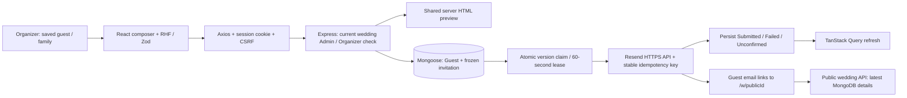
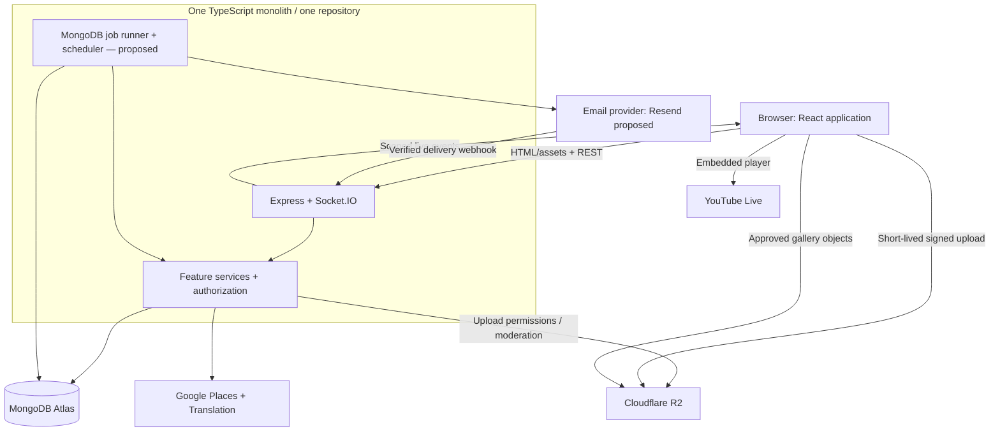
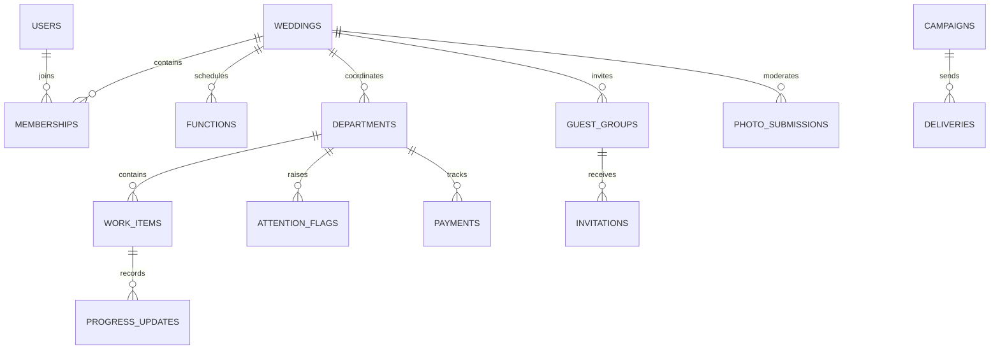
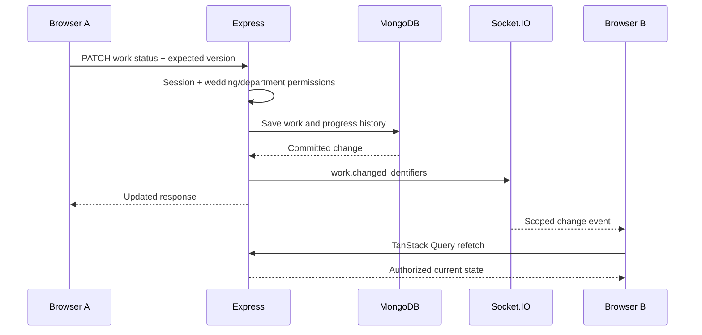
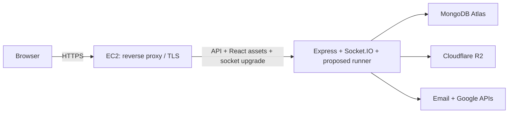
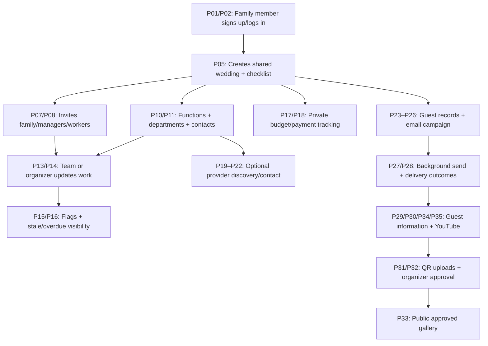

# Make My Marriage — System Design

Version 1.2 · Updated 29 October 2026

Status: Architecture review draft. Confirmed choices are distinguished from proposals. This document designs the application; it does not implement or deploy it.

**Current implementation amendment:** Account → family → wedding → dashboard and public wedding reads are running. Basic guest management and immediate per-family Resend invitations are now implemented as described below. The historical batch/campaign/worker/reminder flows later in this document remain future design, not current V1 behavior. They must not be used to introduce scheduling or BullMQ into this increment. Current sessions use express-session/connect-mongo; MongoDB Atlas/Mongoose remains the source of truth.

### Current V1 invitation process and stack

**Team access implementation amendment:** Wedding embeds both `members` and bounded `teamInvites` arrays. Invitations store hashed random tokens, role, inviter, expiry, revocation and acceptance data. One version-checked `findOneAndUpdate` consumes the invite and pushes membership atomically; the unique `members.userId` index prevents concurrent joins to different weddings. No queue or cross-collection transaction is needed for this flow. Creator is a protected Admin; only creator manages Admin/Organizer membership. Other Admins/Organizers manage Managers/Workers; Managers manage their own invited Workers. Authority is re-read from MongoDB for each private request. The token is in the browser fragment and preview/accept JSON bodies. Invitees return from login/signup and accept without email verification or another wedding setup. Managers/Workers cannot access Budget. Expense persistence, department scoping and socket access-change broadcasts remain planned. The API-design amendment documents actual routes and supersedes provisional P07–P09 transaction/path proposals below.



| Process | Frontend / transport | Backend / persistence |
|---|---|---|
| Open guest directory | React Router `/app/guests`; TanStack Query; Axios | Express session identifies user. MongoDB membership must be Organizer for this wedding. Scoped paginated Guest query returns safe fields and summary. |
| Add/edit family | React Hook Form + Zod; CSRF-protected POST/PATCH | Backend strict Zod schema; server assigns wedding ID. Mongoose persists name/email/side. Version condition rejects stale edits. Submitted/uncertain recipients cannot be changed. |
| Open composer | `/app/guests/:guestId/invitation`; no fixture fallback | Scoped GET returns saved guest, defaults or frozen attempt, wedding version and configured boolean. Credentials never leave the server. |
| Live preview | Debounced subject/note; Axios POST; sandboxed iframe | Same escaped HTML/text renderer as delivery, using actual wedding names/date/venue, map coordinates, contact and optional YouTube link. No provider call. |
| Send now | Disabled while pending; no client automatic retry | Validate session, CSRF, role and expected guest/wedding versions; per-account send limit. Persist full email snapshot and atomically increment guest version to claim it before contacting Resend. |
| Provider acceptance | UI shows **Submitted**, never Delivered | Node fetch to fixed Resend API with 10-second timeout and persisted idempotency key. Save provider ID/time privately. No webhook in this increment. |
| Definite rejection | **Failed**, readable reason, deliberate retry | Persist safe error text, not raw provider diagnostics. Correcting a failed guest clears that rejected draft. A retry otherwise keeps the exact saved payload. |
| Timeout/process crash | **Unconfirmed**; check Resend and refresh status | Network/5xx/ambiguous responses do not imply rejection. A 60-second abandoned lease becomes unconfirmed when read. Retry claims a new lease with the same key/payload. Completion matches lease ID. |
| Retry boundary | Only show Retry when API says `canRetry` | Conservative 23-hour window within Resend's documented 24-hour key lifetime. Old uncertain attempts are blocked for investigation. No automatic retries or background workers. |
| Guest opens email | Website link without registration | Existing `/w/:publicId` and public wedding API return public fields only. Current wedding edits appear there; old email snapshots remain unchanged. |

The Guest document embeds one current invitation snapshot. Fields include wedding scope, normalized recipient name/email/side and version; invitation includes random provider key, lease ID/deadline, frozen sender/recipient/subject/note/HTML/text, outcome, uncertainty marker, timestamps and provider ID. A compound wedding/createdAt/_id index supports the directory. No new queue, Redis, scheduler or session system is added. All required indexes are built during database startup.

`RESEND_API_KEY` and `RESEND_FROM` are optional environment settings until sending is enabled. Missing configuration returns 503 for Send/Retry while guest management and preview remain available. `APP_ORIGIN` generates the guest URL and must be the reachable HTTPS production origin for real recipients. No production mock-success mode exists.

Tests use disposable MongoDB, real HTTP/session/CSRF behavior and an injected stub email sender. They check role/tenant isolation, escaped preview, version conflicts, concurrent sends, persisted outcomes and frozen retries without emailing anyone. This implementation does not claim distributed exactly-once delivery or confirmed inbox delivery.

Product baseline: [PRD v1.2](./Make-My-Marriage-PRD.md). Later discussion clarifies the application routes, session behavior, R2 storage, and location search. Where the PRD contains older assumptions, the decision table below controls this design.

Reading guide: sections 1–15 explain the architecture. [Section 16](#16-service-and-technology-map) maps every application module to its stack. [Section 17](#17-complete-process-flows) contains 36 process flows with a step-by-step technology column. [Section 18](#18-connected-example-and-review-checklist) joins the flows into a complete wedding journey.

The process tables describe a proposed implementation of the agreed product. They do not silently approve unresolved provider choices, policy details, AWS services, or new product features. No password-reset, OTP, booking, RSVP, or payment-processing flow is added to V1.

## 1. Purpose and scope

An organizer-first web application for Indian weddings. Any family member can sign up and independently create a wedding. Both families collaborate in one workspace. Family-managed departments, outside vendors without accounts, and explicitly invited registered providers all fit the same coordination model.

The system supports functions, departmental work, progress history, attention requests, organizer-only finances, a provider discovery directory, email invitations, public guest pages, photo approval, and embedded YouTube Live. Guests do not register or RSVP. There is no booking, admission control, online payment, transport/accommodation management, or seating system.

Wedding is the private-data boundary. Public content is a deliberately limited projection of the wedding, not the full wedding document.

## 2. Decisions and unresolved details

| Component | Selected design | Status |
|---|---|---|
| Architecture | TypeScript modular monolith, one repository | Confirmed |
| Frontend | Vite, React, React Router, Tailwind | Confirmed |
| Forms and server state | React Hook Form, frontend Zod, TanStack Query | Confirmed |
| Backend | Node.js and Express; Express serves React build and API | Confirmed |
| Data | MongoDB Atlas with Mongoose | Confirmed |
| Authentication | Express sessions; no email verification in V1 | Confirmed |
| Session store | connect-mongo in Atlas, alongside application collections | Proposed implementation |
| Live updates | Socket.IO attached to the Express HTTP server | Confirmed |
| Media | Cloudflare R2 | Confirmed |
| R2 layout | Private submissions bucket and public approved-media bucket | Proposed |
| Invitations | Email, not WhatsApp | Confirmed |
| Email provider | Resend | Proposed based on supplied reference |
| Jobs | Durable MongoDB-backed jobs, bounded processing | Proposed; no queue library selected |
| Runner | Small in-process job runner initially; separable entry point later | Proposed, not yet approved |
| Geography | Google Places selection; GeoJSON/2dsphere search for our providers | Confirmed |
| Language | English source UI; Google Cloud Translation for optional Hindi | Confirmed |
| Livestream | YouTube URL/player only | Confirmed |
| Hosting | AWS | Confirmed |
| AWS topology | One EC2 instance, HTTPS reverse proxy, one Node process initially | Proposed; sizing/region/services undecided |

Pending product policies:

1. **Organizer ownership:** creator alone controls fellow-organizer membership, as a provisional reading of the user's instruction. Ownership transfer is not yet specified.
2. **Workspace limit:** one wedding per organizer; providers have one active wedding membership at a time. Reuse after completion/removal is assumed. This does not restrict vendors' real-world bookings.
3. **Reminders:** three checkpoints, 7/4/1 days before an event. Recipient and reference date remain unanswered. This design illustrates organizer attention emails before the main wedding; guest reminders are not silently introduced.
4. **Team invitation acceptance:** valid bearer invitation plus signed-in account, without email verification, is proposed. Whether the email must match is undecided; unverified equality would not prove ownership.
5. **Finance:** all organizer-role members have finance access; no separate finance role is currently planned.
6. **Operational limits:** session lifetime, token lifetime, upload size/count, retention, radius defaults, and email rate limits require configuration decisions.

Correction to the PRD: its A3 note saying guest email invitations are excluded is stale. Guest email invitations are selected in V1.2. Guests need a recipient address for email delivery but do not need an account or address verification.

## 3. Component architecture



MongoDB is the source of truth for application state. R2 stores files; MongoDB stores file references and moderation state. Email delivery is asynchronous. Socket.IO is a change-notification channel, not a database or durable event queue.

Redis, RabbitMQ, Kubernetes, and separate domain microservices are not included in this proposed V1 topology. If MongoDB-backed jobs are rejected, revisit the runner/queue section before implementation.

## 4. Repository and module boundaries

```text
make-my-marriage/
  web/
    src/
      app/                 routing and application bootstrap
      features/            weddings, departments, guests, finance, gallery
      components/          reusable UI
      lib/                 API client and Socket.IO client
  server/
    src/
      app.ts               Express composition
      main.ts              HTTP server, sockets, proposed runner startup
      modules/
        auth/
        weddings/
        memberships/
        functions/
        departments/
        attention/
        finance/
        providers/
        invitations/
        media/
        announcements/
        translation/
      middleware/          session, authorization, errors, request controls
      jobs/                persisted job execution and scheduling
      integrations/        R2, email, Google clients
      realtime/            authorized rooms and change events
  docs/
```

This is a suggested structure, not generated source. Feature routers and handlers may live together; service functions contain reusable business logic. Avoid mandatory controller/repository layers for small operations. Integration clients isolate external APIs without duplicating business rules.

Use frontend Zod for form usability. Backend handlers still check required fields, IDs, enum values, amount ranges, and resource ownership. No separate backend Zod schema framework is required.

## 5. Routes and access boundaries

### Browser routes

| Route | Access | Content |
|---|---|---|
| /signup, /login | Public | Account creation and authentication |
| /app/* | Session required | Organizer, provider, manager, and worker views |
| /w/:slug | Public | Published couple details, approved contacts, generic announcements |
| /w/:slug/i/:inviteToken | No login; valid invitation token | Functions assigned to that invitation |
| /w/:slug/gallery | Public | Approved images only |
| /upload/:uploadToken | Valid upload token always | Submission page; no gallery moderation access |
| /team-invite/:token | Sign in required for acceptance | Proposed collaborator acceptance flow |

The generic public page must not list every private/invitation-specific function. Announcement audience is either public or restricted to relevant invited functions. Guest tokens authorize only their projection, not staff endpoints.

### Representative API contract

All routes below are design examples; complete payload schemas are a later artifact.

| Endpoint | Requirement |
|---|---|
| POST /api/auth/signup, POST /api/auth/login | Public; credentials checked; no email verification |
| GET /api/auth/me | Valid session |
| POST /api/auth/logout | Session and state-change protection |
| POST /api/app/weddings | Signed in; one-wedding creation policy |
| GET /api/app/weddings/:wid/dashboard | Active membership; role-specific projection |
| POST /api/app/weddings/:wid/team-invites | Authorized organizer/manager; no privilege escalation |
| POST /api/app/team-invites/:token/accept | Signed in; valid, unused invitation |
| PATCH /api/app/weddings/:wid/work/:id | Organizer or matching department scope |
| POST /api/app/weddings/:wid/attention | Organizer or matching department scope |
| PATCH /api/app/weddings/:wid/attention/:id/resolve | Organizer |
| GET/POST /api/app/weddings/:wid/finance/payments | Organizer only |
| GET /api/app/providers?lng=...&lat=...&radius=... | Signed in; paginated provider search |
| POST /api/app/weddings/:wid/campaigns | Organizer; persist draft |
| POST /api/app/weddings/:wid/campaigns/:id/send | Organizer; explicit send action |
| POST /api/app/weddings/:wid/photos/:id/approve | Organizer only |
| POST /api/app/weddings/:wid/photos/:id/reject | Organizer only |
| GET /api/public/weddings/:slug | Published public projection |
| GET /api/public/invitations/:token | Valid guest token |
| GET /api/public/weddings/:slug/gallery | Approved records only |
| POST /api/uploads/authorize | Valid upload token; no session required |
| POST /api/uploads/:id/complete | Valid scoped upload permission; object verified |
| POST /api/webhooks/email | Provider signature, not browser session |

Private mutations require both session authentication and authorization. Return 401 for absent/expired login, 403 for insufficient permissions, 409 for conflicting edits, and field-level validation errors for invalid input. Choose a consistent 404 policy for inaccessible nested resources to avoid revealing their existence.

Register API, webhook, and socket handlers before the React HTML fallback. Unknown API paths return API errors, not index.html. In development, Vite proxies API and socket paths to Express. In production, both use the same application origin.

## 6. Authentication and wedding permissions

### Session lifecycle

```mermaid
sequenceDiagram
    participant B as Browser
    participant E as Express
    participant M as MongoDB
    B->>E: Login credentials
    E->>M: Load account
    E->>E: Verify password hash; regenerate session
    E->>M: Persist session containing user ID
    E-->>B: Set session cookie
    B->>E: Private request + cookie
    E->>M: Resolve live session and wedding membership
    E->>E: Check permission and resource scope
    E-->>B: Allowed response or error
```

Use express-session and a MongoDB store, with HttpOnly, Secure in HTTPS production, and SameSite cookie settings. Set saveUninitialized false and select resave behavior compatible with the store. Keep only identity-related data in the session, not a permanent snapshot of every wedding role. Session and membership expiry must be checked on requests; TTL cleanup is not immediate authorization enforcement. Express documents MongoDB session stores and production cookie/proxy considerations. [Express session documentation](https://expressjs.com/en/resources/middleware/session/)

Passwords are stored as adaptive hashes using a vetted library; exact library is pending. Login regenerates the session ID. Logout destroys the store record, clears the cookie, and disconnects sockets associated with that session. Session lifetime and any all-device logout feature remain to be decided.

For cookie-authenticated mutations, include CSRF protection and trusted-origin checking. Allow only configured origins; do not use wildcard credentialed CORS. Trust proxy headers only from the selected deployment proxy. No verification-email gate exists at signup or collaborator acceptance.

### Authorization model

Membership: userId, weddingId, role, departmentIds, status. Creator privilege derives from wedding.creatorId, not a client-provided flag.

Request path: session → user → active membership → role → department/resource scope → response projection.

- Organizers manage all wedding work and finances.
- Managers manage workers and work within assigned departments; they cannot create organizer privileges.
- Workers update scoped work and see cross-department summaries.
- General summaries never include guest lists, budgets, or unrelated internal notes.
- Providers have public profiles independently of private wedding membership.
- Local vendors are service records, not automatically users.

Every nested lookup scopes both resource ID and wedding ID. Explicitly allow editable fields to prevent clients assigning weddingId, role, author, or moderation state.

Team invitation tokens carry server-stored role/department scope, expiry, creator, and consumed/revoked state. Store a token hash. Acceptance atomically consumes the invitation and grants membership; no email verification is required. A single-use bearer link can be accepted by its holder under the proposed policy, so it must not be treated as verified email identity.

## 7. MongoDB model and indexes

Collection names and fields below are a proposed logical model, not finalized Mongoose schemas. Small venue/contact details can be embedded; growing lists and separately queried records use references.

| Collection | Key fields and relationships |
|---|---|
| users | normalizedEmail, passwordHash, displayName, createdAt |
| sessions | Store-owned session data and expiry |
| workspaceAssignments | Proposed capacity guard: userId, kind (organizer/provider), weddingId; one assignment per user/kind |
| weddings | creatorId, slug, couple details, mainDate, timezone, staleInterval, published details |
| memberships | userId, weddingId, role, departmentIds, status |
| teamInvites | weddingId, tokenHash, role, departmentIds, expiresAt, consumedAt |
| functions | weddingId, title, startsAt, endsAt, venue |
| departments | weddingId, name, family/vendor source, optional providerId, contact, lastProgressAt |
| workItems | weddingId, departmentId, title, status, dueAt, version, latest update |
| progressUpdates | weddingId, workItemId, actorId, old/new status, note, onBehalfOf, recordedAt |
| attentionFlags | weddingId, departmentId, optional workItemId, explanation, raisedBy, resolvedBy/At |
| serviceBudgets | weddingId, departmentId, agreedAmountMinor |
| payments | weddingId, departmentId, amountMinor, paidAt, recordedBy, note |
| providerProfiles | ownerId, category, service location GeoJSON, service radius, portfolio, stated availability |
| reviews | weddingId, departmentId, providerId, authorId, rating, text, moderation state |
| guestGroups | weddingId, family label, optional names/estimate, email, side, functionIds |
| invitations | weddingId, guestGroupId, tokenHash, allowed functionIds, revokedAt, optional expiry |
| uploadTokens | weddingId, tokenHash, expiry, revokedAt, quotas |
| campaigns | weddingId, actorId, invitation image reference, recipient snapshot, status |
| deliveries | Optional campaignId, weddingId, recipient snapshot, dedupeKey, providerMessageId, submission status, event results, encrypted retry payload |
| jobs | type, referenceId, dedupeKey, state, runAt, attempts, lease owner/until, last error |
| reminderCheckpoints | Proposed weddingId, recipientId, checkpoint, scheduledAt, outcome; unique checkpoint delivery identity |
| webhookEvents | provider event ID, message ID, processing outcome |
| mediaAssets | wedding/profile ownership, purpose, staging/review/public object keys, verified state, original metadata |
| photoSubmissions | weddingId, private object key, state, reviewer, public object key, timestamps |
| announcements | weddingId, audience/functionIds, text, publication state |
| translationCache | source/version hash, targetLanguage, translated display text |
| auditEvents | Proposed actorId, weddingId, action, resource reference, time; limited nonsecret metadata for membership/finance changes |



Index plan:

- Unique normalized user email and wedding slug.
- Unique membership userId + weddingId; department scope is stored in that membership.
- Proposed unique userId + kind capacity guard in workspaceAssignments, acquired with wedding creation or membership acceptance. Membership uniqueness alone does not enforce one wedding per organizer/provider. Release/reuse policy follows the unresolved workspace policy, not an automatic assumption.
- Token-hash uniqueness and expiry indexes. TTL may clean up records, but handlers must reject expired tokens immediately. [MongoDB TTL documentation](https://www.mongodb.com/docs/manual/core/index-ttl/)
- weddingId + departmentId + status/deadline for work; weddingId + recordedAt for history.
- weddingId + unresolved state for manual attention requests.
- Provider location 2dsphere index; category filter. GeoJSON order is longitude, latitude.
- Unique delivery/job dedupe keys and provider webhook event IDs.
- jobs state + runAt and leaseUntil for polling/recovery.
- weddingId + photo state + createdAt for moderation/gallery pagination.
- Unique review for completed service under the provisional review policy.

Store money as integer paise, timestamps in UTC, and wedding timezone separately. Pending balance is agreed amount minus recorded paid amount; clarify overpayments rather than silently clamping them to zero.

Use explicit version fields for updates susceptible to concurrent edits. PATCH with expectedVersion changes only matching records; otherwise return 409 and refresh. Function overlap checks need serialized/versioned schedule edits if two organizers create functions concurrently. Define that write strategy before implementation; a query-before-insert check alone is insufficient.

Transactions are reserved for coupled writes such as consuming team invites with membership creation or saving progress plus its audit record. Do not wrap unrelated reads/writes in transactions. Final transaction boundaries need review.

## 8. Progress, attention, and real-time updates

Statuses remain todo, in_progress, done. An attention flag is independent; resolving it does not mark work done. Organizers can enter vendor-reported updates, with actor and source preserved.

Compute automatic attention reasons from unfinished work:

- Overdue: dueAt is before now.
- Stale service: no meaningful progress since lastProgressAt, or creation if none, beyond configured interval; default six days.
- Manual: unresolved attentionFlags.

Combine reasons per department. Read-only visits and contact edits do not reset progress time. A completed department's work is excluded from automatic stale/overdue reasons, but unresolved manual flags remain until resolved. Implement one attention calculation shared by dashboard and summaries.



Share session middleware with Socket.IO. Rooms are assigned on the server only after membership checks; never accept an arbitrary room name from the browser. Suggested rooms: user:{uid}, session:{sid}, wedding:{wid}:team, wedding:{wid}:organizers, and department:{did}. [Socket.IO session integration](https://socket.io/how-to/use-with-express-session)

Events include work.changed, attention.changed, announcement.changed, campaign.changed, and photo.review.changed. Payloads contain IDs/version/time, not full private documents. Financial change events go only to organizers. Guest pages can refetch on focus or periodically; guests need not join private sockets.

Revalidate subscriptions on reconnect and periodically while connected. Logout, expiry, or membership removal disconnects/restricts sockets; handlers must not keep trusting a stale handshake session forever. Re-fetch queries after reconnect because events are not guaranteed durable. A successful database write remains successful if a socket emit fails.

## 9. Invitations and background processing

### Invitation campaign

Organizer drafts campaign → selects guest groups → reviews recipient snapshot and invitation → explicitly starts sending. Missing email records are shown as unsendable without preventing guests being kept in planning records.

Each recipient gets an invitation-specific URL. Store only hashes of access tokens; redact raw tokens from logs and apply a referrer policy on token pages. Public gallery remains login-free and does not require invitation tokens.

Token lookup records store hashes, but email retries still need the original invitation URL. Keep that URL in a short-lived encrypted delivery payload, or use another reviewed method that can safely reproduce it. A hash alone cannot reconstruct the link. Keep payload encryption keys out of MongoDB and remove delivery payloads according to the retention policy. This mechanism is a design proposal, not a finalized encryption-library choice.

### Proposed simple runner

Begin with one Express process and a small asynchronous polling runner using MongoDB jobs. This is a review proposal. It avoids Redis/RabbitMQ but requires persisted state; setTimeout alone is not the scheduler. A separate entry point can later run the same processor without changing business logic.

1. Store delivery intent before external calls, with a stable unique logical key.
2. Create/upsert its job. A reconciler creates missing jobs for persisted unsent intents, avoiding a crash gap between intent and scheduling.
3. Atomically claim a due job using a lease and increment attempts; process limited concurrency.
4. Send email outside the MongoDB transaction. Save provider ID and accepted outcome.
5. Finish/retry with the claim's lease identifier so an expired worker cannot overwrite a newer worker's result.
6. Recover expired leases and retry transient failures with bounded backoff. Permanent failures require organizer review.

States: pending → processing → submitted/completed, retry_wait, failed, or cancelled. Submission and actual email delivery are separate. Background polling must be asynchronous and bounded so it does not overwhelm the API process.

External delivery cannot be made exactly-once by MongoDB alone. If the provider accepted an email but the response was lost, a retry can duplicate it. Resend supports idempotency keys with a limited retention window; use a stable key per intended message, keep retries within applicable guarantees, and mark ambiguous older outcomes for reconciliation rather than blind resend. [Resend idempotency documentation](https://resend.com/docs/dashboard/emails/idempotency-keys)

### Delivery webhooks

Verify provider signature against the unmodified payload before processing. Persist unique event ID and message result idempotently, correlate providerMessageId, and handle callbacks that arrive before the send response is recorded. Duplicate or out-of-order events must not reset a delivered/bounced outcome to merely submitted. Persist events before acknowledging so processing can resume after a crash. Do not require a user session for a signed provider webhook. [Resend webhooks](https://resend.com/docs/webhooks/introduction)

### Reminder scheduling, pending product confirmation

Illustrative policy: organizer attention emails at 09:00 wedding-local time, 7/4/1 calendar days before mainDate. Evaluate attention at execution, not months in advance. Persist checkpoint records keyed by wedding + checkpoint + recipient. Skip empty summaries; do not backfill past checkpoints automatically.

When date changes, update unsent due times and cancel obsolete pending jobs. Preserve sent checkpoints so moving the date does not automatically send them again. If process downtime spans a checkpoint, the allowed lateness window must be decided before implementation. Retry attempts are the same logical message, not additional reminder checkpoints.

## 10. R2 photo and invitation storage

Two buckets are proposed: private submissions and public approved media. R2 bucket visibility is not determined by a MongoDB photo.status field. Never put pending images into a publicly readable bucket. Use a custom media domain for approved assets if this layout is approved. [R2 public buckets](https://developers.cloudflare.com/r2/buckets/public-buckets/)

```mermaid
sequenceDiagram
    participant G as Guest
    participant E as Express
    participant R as Private R2
    participant O as Organizer
    participant P as Public R2
    G->>E: Upload token + file metadata
    E->>E: Token, quota, and type checks
    E-->>G: Short-lived signed upload + submission ID
    G->>R: Upload to server-chosen key
    G->>E: Complete submission
    E->>R: Freeze review copy; validate the frozen image
    E-->>O: Pending review with short-lived preview access
    O->>E: Approve
    E->>P: Copy reviewed image to public key
    E->>E: Mark approved after successful copy
    E-->>G: Photo appears in gallery
```

Presigned URLs authorize a specific operation/object until expiry. Keep R2 credentials server-side and restrict bucket CORS to the application. A browser-declared MIME type is not enough: verify size and actual decodable image content after upload. Reject oversized/unsupported objects and enforce wedding-level quotas. [R2 presigned URLs](https://developers.cloudflare.com/r2/api/s3/presigned-urls/)

Upload links can be revocable, but already issued presigned URLs remain usable until expiry. On completion, copy the staged object to a server-controlled immutable review key and validate that frozen copy before marking it pending. This prevents a reusable upload URL from replacing the image between validation and approval. Organizer approval references that reviewed object, not the guest-writable staging key.

R2 and MongoDB do not share a transaction. Use intermediate uploading/pending/publishing/approved/rejected states and retryable reconciliation. Publish only after successful copy; reconcile orphan public objects and incomplete uploads. Rejecting removes staged/private media asynchronously. Unpublishing removes gallery access and deletes the public object; handle cache invalidation where relevant. Previously downloaded copies cannot be revoked.

Prepared invitation images use distinct asset records and visibility rules; making an invitation public must not accidentally publish pending gallery objects. Exact file limits, token expiry, retention, and two-bucket approval are unresolved.

## 11. Location, translation, and YouTube

### Location

Google Places helps select a location; it is not the source of our provider profiles, reviews, or stated availability. Use a GeoJSON point for provider locations, then query registered providers within a configured radius using MongoDB. Keep user-entered address/landmark text for readability.

Store Place IDs and retain Google-returned fields only as permitted by the applicable API terms; latitude/longitude returned by Google is not automatically unrestricted permanent application data. Preserve provenance and verify storage/refresh/attribution rules before deciding field retention. Request only required fields and restrict keys. A browser Places widget may use a browser-restricted key; backend API credentials stay server-side. [Google Places policies](https://developers.google.com/maps/documentation/places/web-service/policies)

Directions open Google Maps using the selected destination. No custom route optimizer or guarantee of fastest arrival is implemented.

### Translation

English is the authored source. Translate selected interface labels to Hindi through the backend, cache by source/version and language, and fall back to English on failures. Do not automatically send budgets, personal guest lists, private notes, phone numbers, or tokens for translation. No separate manually authored Hindi website is required. The translation integration is distinct from Google Places. [Cloud Translation text documentation](https://docs.cloud.google.com/translate/docs/basic/translating-text)

### YouTube

Organizer supplies a YouTube Live URL. Validate/extract the video ID and generate a controlled embed URL, not arbitrary iframe HTML. Broadcasting and recording happen on YouTube. Display schedule and an Open in YouTube fallback if embedding is unavailable. No video traffic passes through Express/R2.

## 12. Frontend data flow

React Router provides /app layouts and guest/upload routes. Auth gating improves navigation; backend rules remain authoritative. Fetch current user with TanStack Query instead of a large global Context architecture.

Suggested query keys include [me], [wedding, wid, dashboard], [wedding, wid, departments], [wedding, wid, department, did], [wedding, wid, finance], [wedding, wid, attention], and [wedding, wid, campaign, cid].

Mutations invalidate related keys. Socket events invalidate the same keys. Avoid manually keeping a second copy of server records in local component state. Use local state for UI choices, RHF for forms, and Zod for field errors. Clear user-scoped query caches on logout/account change so a different account does not briefly see previous private data.

Guest access tokens stay separate from staff sessions. Do not log them through analytics or error reporting. Calendar dates and times render in the wedding timezone, including reminder explanations.

## 13. AWS deployment proposal

AWS is confirmed; this topology is a recommendation for review, not a deployment decision.



Start with one web instance, no load balancer or Kubernetes. Keep Node on an internal port; proxy the public domain and WebSocket upgrade. React assets are served by Express as selected. Choose a process supervisor and restart policy; terminate jobs gracefully and leave recoverable leases on interrupted work.

Use HTTPS, constrained network rules, deployment-managed secrets, an Atlas network-access policy, and separate production/development databases and credentials. Logs need request/job IDs without passwords, sessions, access tokens, or guest addresses. Backups and restore verification belong to operational readiness.

EC2 is a general-purpose compute option; instance region/size, DNS, certificate approach, secret storage, monitoring, and Atlas backup tier require a deployment review. No uptime or capacity guarantee is implied by one instance. [Amazon EC2 overview](https://docs.aws.amazon.com/AWSEC2/latest/UserGuide/concepts.html)

If multiple web instances become necessary, revisit Socket.IO routing/adapter coordination, proxy behavior, job concurrency, and shared rate limits. This is a future trigger, not a Redis requirement for V1.

## 14. Failure handling and verification

| Failure | Expected behavior |
|---|---|
| MongoDB unavailable | Private operations fail visibly; do not claim work saved or accept unpersisted email jobs |
| Socket lost | REST still works; reconnect/focus refetches current state |
| Job process crashes | Persisted jobs recover after lease expiry; external sends reconciled before retry |
| Email provider rejects recipient | Delivery failure visible to organizer; no endless retry |
| Duplicate webhook | Unique event processing; outcome not counted twice |
| R2 upload incomplete | No public photo; abandoned record/object cleanup |
| R2 copy fails during approval | Remains nonpublic in publishing/error state; retryable |
| Guest/upload token revoked | New API authorizations denied; issued signed URLs expire shortly |
| Member removed | Private API denied and sockets disconnected/re-authorized |
| Concurrent edits | Version conflict rather than silent overwrite for protected records |
| Translation fails | English UI remains usable |
| YouTube embed blocked | Open in YouTube fallback |

Focused tests: cross-wedding ID access, worker finance denial, manager privilege escalation, session expiry/logout, token replay, progress history/version conflicts, room subscription denial, duplicate email jobs/webhooks, reminders across date changes, pending-photo visibility, guest-writable object replacement, and provider geospatial filters.

Manual verification: two-browser live updates, guest link without login, family-managed departments without vendors, R2 approval/rejection, Hindi fallback, and restart recovery. Choose test tooling later; Vitest/Supertest are candidates, not prerequisites imposed on this design.

## 15. Design and implementation roadmap

| Stage | Review artifact | Then implementation scope |
|---|---|---|
| 1 | Resolve pending policy table and process topology | Repository/bootstrap only after authorization |
| 2 | Session lifecycle and permission matrix | Signup/login, memberships, invitation acceptance |
| 3 | Mongoose fields/indexes and concurrency rules | Wedding/functions/departments/work and attention |
| 4 | REST response projections and query keys | Organizer dashboard and private finance |
| 5 | Socket event/room contract | Live progress and revoked access behavior |
| 6 | Token and R2 lifecycle | Guest pages, uploads, moderation, public gallery |
| 7 | Job state machine and email provider contract | Email campaigns, webhooks, reminder checkpoints |
| 8 | Provider geography/review rules | Directory/search, Google selection, translation, YouTube |
| 9 | Failure-focused verification plan | Tests and restart/recovery checks |
| 10 | AWS deployment diagram and cost/limits | Deploy only when requested |

No implementation has begun. The next architecture review should resolve runner execution, email provider, team-invite acceptance, reminder recipients/date, and R2 bucket layout before source scaffolding.

## 16. Service and technology map

“Service” below means an internal application module or external integration. Internal modules remain inside the Express monolith; they are not independent microservices.

| Module/integration | Frontend technology | Backend technology | Persistence/external system | Process IDs |
|---|---|---|---|---|
| Account and sessions | React, RHF/Zod, TanStack Query, Router | Express, express-session; connect-mongo proposed | Atlas users and sessions | P01–P04 |
| Wedding workspace | React setup/settings forms | Express wedding services, Mongoose | weddings, memberships, departments, workItems | P05–P06 |
| People and roles | Team forms and invite-acceptance page | Session and scoped permission middleware; token handling | teamInvites, memberships | P07–P09 |
| Functions and venue | Function forms, location selection | Express, Mongoose; Google integration | functions; embedded venue details | P10 |
| Departments/checklist | Department and checklist screens | Department/work services | departments, workItems, progressUpdates | P11–P14 |
| Attention | Dashboard cards and issue form | Shared attention calculation, flag services | attentionFlags + derived work conditions | P15–P16 |
| Finance | Organizer-only forms and summaries | Explicit finance authorization and aggregation | serviceBudgets, payments | P17–P18 |
| Provider directory | Profile form, filters, search results | Profile/search/review services | providerProfiles, reviews, Atlas 2dsphere index | P19–P22 |
| Guests/invitations | Guest-list forms and campaign preview | Token generation, campaign services | guestGroups, invitations, campaigns | P23–P26 |
| Email delivery | Campaign outcomes via TanStack Query | Proposed job runner and email adapter; signed webhook | MongoDB jobs/deliveries; Resend proposed | P27–P28 |
| Public wedding website | React public routes; no auth guard | Public projection endpoints | Published wedding/function/announcement data | P29–P30 |
| Photo submission/moderation | Browser file upload; review screens | Upload token checks; object verification; R2 adapter | R2 + photoSubmissions/uploadTokens | P31–P33 |
| Directions/contact | Map link and tap-to-call actions | Published-contact projection | Google Maps navigation link; phone dialer | P34 |
| Livestream | YouTube embedded player | Safe video-ID extraction and saved configuration | YouTube Live | P35 |
| Hindi translation | Language toggle, small display-text helper | Translation adapter and cached labels | Google Cloud Translation + translationCache | P36 |
| Live events | socket.io-client → query invalidation | Socket.IO sharing Express session | Authorized in-memory rooms; Atlas is source of truth | P13 and P09/P04 |
| Hosting/release | Vite production bundle | Express and proposed background runner | AWS selected; exact deployment pending | Section 18 |

Common stack in every application flow: TypeScript. RHF means React Hook Form. MongoDB writes/reads use Mongoose except session-store operations owned by the proposed connect-mongo library. Resend, the job-runner layout, two-bucket R2 layout, and AWS service choices remain proposals even when illustrated below.

### Process-to-endpoint reference

These contracts expand section 5 so every module has an implementation entry point. Route names and payload shapes are review proposals, not implemented APIs. `:wid` is wedding ID and `:id` is a scoped record ID.

| Process | Proposed endpoint(s) | Access |
|---|---|---|
| P01–P04 | POST /api/auth/signup; POST /api/auth/login; GET /api/auth/me; POST /api/auth/logout | Public credentials endpoints; session where applicable |
| P05–P06 | POST /api/app/weddings; PATCH /api/app/weddings/:wid; POST /api/app/weddings/:wid/publish | Session; organizer for existing wedding |
| P07–P08 | POST /api/app/weddings/:wid/team-invites; GET /api/team-invites/:token; POST /api/app/team-invites/:token/accept | Authorized inviter; token-limited preview; session for accept |
| P09 | PATCH/DELETE /api/app/weddings/:wid/memberships/:id | Hierarchy and department/creator policy |
| P10 | POST /api/app/weddings/:wid/functions; PATCH/DELETE /api/app/weddings/:wid/functions/:id | Organizer |
| P11 | POST /api/app/weddings/:wid/departments; PATCH /api/app/weddings/:wid/departments/:id; POST .../work | Organizer; scoped manager for work |
| P12 | GET /api/app/weddings/:wid/dashboard | Active membership, role-specific projection |
| P13–P14 | PATCH /api/app/weddings/:wid/work/:id; GET .../work/:id/history | Organizer or permitted department staff |
| P15–P16 | POST /api/app/weddings/:wid/attention; PATCH .../attention/:id/resolve; GET .../attention | Scoped staff can raise; organizer can resolve; scheduler is internal |
| P17–P18 | PATCH /api/app/weddings/:wid/finance/budget; PUT .../finance/services/:id; GET/POST .../finance/payments; PATCH/DELETE .../finance/payments/:id | Organizer only |
| P19 | POST /api/app/provider-profile; PATCH /api/app/provider-profile | Signed-in profile owner |
| P20–P21 | GET /api/app/providers; GET /api/app/providers/:id; POST /api/app/weddings/:wid/departments | Signed-in search; organizer adds wedding contact |
| P22 | POST /api/app/weddings/:wid/departments/:id/review | Organizer with eligible completed service |
| P23–P24 | POST /api/app/weddings/:wid/guests; PATCH .../guests/:id; POST .../guests/:id/invitations; POST .../invitations/:id/revoke | Organizer |
| P25 | POST /api/app/assets/authorize; POST /api/app/assets/:id/complete | Session + purpose/ownership checks |
| P26–P28 | POST /api/app/weddings/:wid/campaigns; POST .../campaigns/:id/send; GET .../campaigns/:id; POST .../deliveries/:id/retry; POST /api/webhooks/email | Organizer; signed provider webhook; job runner internal |
| P29–P30 | GET /api/public/weddings/:slug; GET /api/public/invitations/:token; POST/PATCH /api/app/weddings/:wid/announcements | Public/scoped token reads; organizer writes |
| P31 | POST /api/app/weddings/:wid/upload-tokens; POST .../upload-tokens/:id/revoke; POST /api/uploads/authorize; POST /api/uploads/:id/complete | Organizer creates/revokes; token-required guest upload |
| P32–P33 | GET /api/app/weddings/:wid/photos; POST .../photos/:id/approve; POST .../photos/:id/reject; POST .../photos/:id/unpublish; GET /api/public/weddings/:slug/gallery | Organizer moderation; public approved gallery |
| P34–P35 | Published fields in guest response; PATCH /api/app/weddings/:wid/functions/:id or wedding settings | Guest reads eligible config; organizer writes |
| P36 | POST /api/translation/labels | Public bounded allowlisted label translation; no arbitrary private content |

Places location selection may use a reviewed backend proxy or a browser-restricted widget. Its credential/display design is not finalized; the provider search endpoint always queries our own Atlas collection.

## 17. Complete process flows

Each process identifies the entry point, actor, access requirement, step-by-step behavior, and technology used at that step. Endpoints are proposed contracts. Only the product capabilities and tools marked confirmed in section 2 are final choices.

| Group | Processes |
|---|---|
| Identity | P01 signup; P02 login; P03 session restore/private request; P04 logout/expiry |
| Wedding/team | P05 create wedding; P06 edit/publish; P07 invite collaborator; P08 accept invite; P09 change/revoke access |
| Planning | P10 functions/venue; P11 departments/checklist; P12 dashboard; P13 work update/live refresh; P14 organizer update/history |
| Attention/finance | P15 manual flags; P16 stale/overdue/reminders; P17 budget/cost; P18 payment records |
| Directory | P19 provider profile; P20 nearby search; P21 add provider/contact; P22 review |
| Invitations | P23 guest records; P24 guest access tokens; P25 invitation image; P26 email campaign; P27 jobs; P28 webhooks/retries |
| Guest/media | P29 wedding/invitation viewing; P30 announcement; P31 QR submission; P32 approval/rejection/unpublish; P33 gallery |
| Integrations | P34 call/directions; P35 YouTube; P36 Hindi translation |

### P01 — Sign up and immediately start using the platform

Actor: any family member or a service provider. Entry: `/signup`, `POST /api/auth/signup`. No existing session or verified email required.

Flow: **Form → basic checks → password hash → user record → proposed automatic session → /app**.

| Step | What happens | Technology and data |
|---|---|---|
| 1 | User enters name, email, password. Show format/password errors locally. | React + RHF + Zod; no verification step |
| 2 | Submit via mutation; normalize email and check allowed fields on the server. | TanStack Query → Express |
| 3 | Hash the password with a vetted adaptive hash library. Library is pending, not a custom hash implementation. | Node.js password adapter |
| 4 | Create the account; unique normalized-email index handles concurrent duplicate registrations. | Mongoose → Atlas users |
| 5 | Proposed UX: regenerate/persist a new session for the new user and send an HttpOnly cookie. | express-session → MongoDB session store |
| 6 | Refresh `[me]`; show wedding setup or valid team-invitation continuation. Provider can open profile setup. | TanStack Query + React Router |

Result: account usable without OTP or email verification. New accounts do not choose arbitrary privileged roles; organizer privileges arise from wedding creation or authorized membership. Duplicate account → conflict; failed session persistence → do not claim login succeeded. If account creation succeeded before session failure, user can log in without registering again. Automatic signup login is a UX proposal; login itself is confirmed.

### P02 — Login

Actor: registered organizer/manager/worker/provider. Entry: `/login`, `POST /api/auth/login`.

Flow: **Credentials → password verification → regenerate session ID → save session → authenticated application**.

| Step | What happens | Technology and data |
|---|---|---|
| 1 | Enter credentials; send login mutation. | React/RHF → TanStack Query → Express |
| 2 | Find account by normalized email and compare password hash; return a generic credentials error on failure. | Mongoose users + password adapter |
| 3 | Regenerate session ID to avoid retaining a pre-login session; associate only the user's identity. | express-session |
| 4 | Save session before returning success and set cookie attributes for the environment. | MongoDB session store + HTTP Set-Cookie |
| 5 | Fetch account/membership summary; route to its workspace or setup screen. | GET /api/auth/me + React Router |
| 6 | Connect live client only after session establishment. Server validates session and membership. | socket.io-client + Socket.IO |

Result: authenticated identity, not a global organizer permission. Wrong credentials are rejected. An absent wedding membership does not prevent using setup or provider profile screens. Login checks can be rate-limited without introducing V1 email verification.

### P03 — Restore a session and open a protected page/API

Actor: signed-in staff member. Entry: refresh/open `/app/*`, then `/api/auth/me` and a scoped endpoint.

| Step | What happens | Technology and data |
|---|---|---|
| 1 | React starts and requests current identity; render a loading state while checking. | Vite React bundle + TanStack Query `[me]` |
| 2 | Browser sends session cookie automatically on same-origin requests. | Browser cookie + Express |
| 3 | Load the server session and reject missing/expired identity. Session data lives in MongoDB, not in the cookie. | express-session + session store |
| 4 | For wedding data, load active membership and validate role plus department/resource scope. | Mongoose memberships and target record |
| 5 | Return only permitted fields; organizer dashboard may include finance, worker response does not. | Express response projection |
| 6 | Router permits private layout, redirects unauthenticated users to login, or displays forbidden access. | React Router; API 401/403 remains authoritative |

Result: refreshing does not require re-login while session is valid. A React route guard never replaces API authorization. Staff list/finance projections have separate query keys and appropriate cache boundaries.

### P04 — Logout and session expiry

Actor: signed-in user, or automatic expiry. Entry: `POST /api/auth/logout` or rejected session check.

| Step | What happens | Technology and data |
|---|---|---|
| 1 | User clicks logout; protect the state-changing request. | React mutation + Express CSRF/origin checks |
| 2 | Destroy session in its store; clear browser cookie using matching cookie attributes. | express-session + MongoDB |
| 3 | Disconnect sockets attached to that session. Expired sockets are detected through periodic revalidation as well. | Socket.IO session room |
| 4 | Clear user-scoped query caches and local private state; return to login/public page. | TanStack Query + React Router |
| 5 | On later API/socket activity, reject stale session even if database TTL cleanup has not removed it yet. | Express/Socket.IO session checks |

Result: previous private data is not shown after switching accounts. All-device logout is not added to V1. Lifetime and idle/absolute expiry values remain configurable decisions.

### P05 — Create wedding and seed checklist

Actor: any signed-in family member, couple member, or planner. Entry: `/app/setup`, `POST /api/app/weddings`.

| Step | What happens | Technology and data |
|---|---|---|
| 1 | Fill couple names, main wedding date/timezone, contact details, and optional photos. | React + RHF/Zod; photo assets follow P25's staff asset flow |
| 2 | Verify session and one-wedding organizer policy; assign creator from session, not request body. | Express + membership policy |
| 3 | Create wedding with unique slug and organizer membership for creator. | Mongoose weddings/memberships |
| 4 | Seed editable checklist/departments such as catering and photography. No vendor/account is required. | Department/work service → Atlas |
| 5 | Keep setup retry-safe so a repeated request does not create two weddings or duplicate template items. | Unique creator/workspace guard + request identity proposed |
| 6 | Return workspace; invalidate membership/dashboard queries and open `/app`. | TanStack Query + Router |

Result: a family-managed wedding exists. Checklist entries may be deleted or renamed; photography is a suggestion, not an enforced service. Coupled setup writes use a transaction or reviewed recoverable setup state; concurrent requests must enforce the one-wedding rule atomically.

### P06 — Edit wedding details and publish guest information

Actor: organizer. Entry: settings and publish controls under `/app`.

| Step | What happens | Technology and data |
|---|---|---|
| 1 | Edit permitted wedding fields and select which generic information is public. | React settings form |
| 2 | Check organizer membership and expected record version. | Express authorization + Mongoose |
| 3 | Save details; maintain an explicit published projection/state. Wedding finances and team notes cannot be published through these fields. | Atlas weddings; media references |
| 4 | If main date/timezone changes, reschedule unsent reminder checkpoints under the proposed reminder policy. | Shared scheduler → jobs/checkpoint records |
| 5 | Invalidate private/public view caches and broadcast a minimal permitted change event. | TanStack Query + Socket.IO |

Result: `/w/:slug` exposes only published fields. Conflict returns 409. Changing couple photos uses staff upload, not the unrestricted guest gallery moderation path. Publication scope is independent from finance and invitation function access.

### P07 — Invite another organizer, manager, or worker

Actor: authorized creator/organizer/manager. Entry: team screen, `POST /api/app/weddings/:wid/team-invites`.

| Step | What happens | Technology and data |
|---|---|---|
| 1 | Choose role and department scope, and optionally enter recipient email for sending the link. | React/RHF team form |
| 2 | Check inviter can grant that role; managers can invite workers only within their scope. Creator-only organizer invitation remains provisional. | Express permission service |
| 3 | Generate high-entropy single-use token; store hash, scope, expiry, creator, and unused state. | Node crypto + Mongoose teamInvites |
| 4 | Show acceptance link or send it via email job; recoverable email link payload is encrypted as described in section 9. | Express + proposed email jobs |
| 5 | Recipient opens `/team-invite/:token`; show limited invitation details and sign-in/signup if needed. | React Router + restricted token endpoint |

Result: invitation alone is not active wedding membership. Revoking it prevents new acceptance. No verification email is required. Sharing versus automatic delivery of team links is a UX choice, not a guest-invitation channel change.

### P08 — Accept collaborator invite without email verification

Actor: signed-in recipient. Entry: `POST /api/app/team-invites/:token/accept`.

| Step | What happens | Technology and data |
|---|---|---|
| 1 | Preserve invite continuation through signup/login; do not put raw tokens into analytics/logs. | React Router + auth flow |
| 2 | Hash presented token and check validity, expiry, revocation, and stored scope. | Node crypto + Mongoose teamInvites |
| 3 | Check recipient workspace/provider limits and current inviter authority. Final bearer-versus-email-matching policy is pending. | Membership policy service |
| 4 | Atomically consume invitation and create/update recipient membership without allowing a repeated token to grant another account access. | Atlas transaction/unique constraints proposed |
| 5 | Fetch new membership; redirect to relevant department/dashboard and authorize socket subscriptions. | TanStack Query + Socket.IO |

Result: account joins without email verification. Concurrent acceptances cannot both succeed for different people. An already-completed acceptance by the same account may return its existing membership; another account gets rejected.

### P09 — Change roles, remove members, and revoke live access

Actor: permitted organizer or department manager. Entry: people screen and scoped membership endpoints.

| Step | What happens | Technology and data |
|---|---|---|
| 1 | Select member and allowed action: change department/role or remove access. | React team screen |
| 2 | Validate actor hierarchy, creator restrictions, target wedding, and department scope. | Express permission service |
| 3 | Save membership change and audit actor/time; do not remove historical work records. | Mongoose memberships + audit record |
| 4 | Disconnect/re-authorize affected sockets so old rooms cannot keep receiving private changes. | Socket.IO user/session subscriptions |
| 5 | Private requests now use changed membership; invalidate member's cached views on access-change signal/reconnect. | Express checks + TanStack Query |

Result: revocation affects APIs and live access, not only navigation buttons. Creator removal/ownership transfer is unresolved and should not be invented in implementation.

### P10 — Create/edit functions and select a venue

Actor: organizer. Entry: functions screen under `/app`.

| Step | What happens | Technology and data |
|---|---|---|
| 1 | Enter function name, dates/times, and venue/entrance details. | React + RHF/Zod |
| 2 | Search/select a place; resolve needed location fields or supply user-confirmed coordinates/address. | Google Places adapter; attribution/storage policy |
| 3 | Convert local time to UTC while preserving wedding timezone; validate start/end and function schedule rules. | Node date/time handling; library undecided |
| 4 | Serialize conflicting schedule edits using a wedding schedule version/transaction strategy; enforce non-overlap. | Express + Mongoose/Atlas |
| 5 | Save function and eligible invitation references; update dashboards and affected invitation views. | functions + guestGroups/invitations |
| 6 | Broadcast scoped schedule change and refresh queries. | Socket.IO + TanStack Query |

Result: each function has a clear time and venue; no parallel functions. Deleting a function must update or retire invitation references consistently and avoid accidentally broadening guest access.

### P11 — Add department, family responsibility, local vendor, or checklist work

Actor: organizer; managers maintain permitted department work. Entry: departments/checklist screen.

| Step | What happens | Technology and data |
|---|---|---|
| 1 | Add department or edit template items; select family-managed or vendor-managed source. | React forms |
| 2 | Optionally enter local vendor phone/details. Do not create a user account for an outside vendor. | Express department service |
| 3 | Save department and work items with status/deadline; individual owner is not mandatory. | Mongoose departments/workItems |
| 4 | Optionally invite actual collaborators separately using P07/P08. Contact records do not grant access. | Membership module |
| 5 | If organizer enters agreed cost, save it through finance authorization separately from common department details. | finance serviceBudgets |
| 6 | Refresh department list and dashboard. | TanStack Query; minimal Socket.IO event |

Result: full planning works without hiring anyone. Removing an unused template item is allowed; removing a department with payments/history needs a reviewed archive policy rather than cascading away financial records.

### P12 — Load organizer/manager/worker dashboard

Actor: staff with membership. Entry: `GET /api/app/weddings/:wid/dashboard`.

| Step | What happens | Technology and data |
|---|---|---|
| 1 | Fetch dashboard using a wedding-scoped query key. | React + TanStack Query |
| 2 | Resolve active membership and select response projection. | Express authorization |
| 3 | Fetch department summary, next functions, scoped work, and derived/manual attention. | Mongoose reads + attention calculator |
| 4 | Only organizers get finance totals and private guest/campaign controls. | Separate finance queries/projection |
| 5 | Render status words plus colors, last-updated times, contacts, and actionable attention cards. | React + Tailwind |
| 6 | Subscribe to authorized change events; refetch on reconnect/focus and a configured periodic interval for time-derived attention. | Socket.IO + TanStack Query |

Result: workers see own detailed work plus other departments' safe progress summary. A stale/overdue condition can appear as time passes even if nobody sends a socket event.

### P13 — Update work and refresh other people's screens

Actor: organizer or authorized department member. Entry: `PATCH /api/app/weddings/:wid/work/:id`.

| Step | What happens | Technology and data |
|---|---|---|
| 1 | Choose To do/In progress/Done and optional meaningful update note. | React work controls |
| 2 | Submit allowed fields with expectedVersion; check work wedding and department membership. | TanStack mutation → Express |
| 3 | Save work, audit update, and department progress time consistently. Actor/time are server-assigned. | Mongoose/Atlas coupled-write strategy |
| 4 | After successful save, emit work.changed with IDs/version only to permitted rooms. | Socket.IO |
| 5 | Other clients invalidate work, department, dashboard, and attention queries as needed. | TanStack Query |
| 6 | Reconnect fetches authoritative state; register listeners once and clean them up to prevent duplicate subscriptions. | socket.io-client + ordinary React effects |

Result: database write remains successful if event delivery fails. Version conflict returns 409 and prompts refresh. A no-op/read-only action does not count as progress; a genuine update note can count even if status remains In progress.

### P14 — Organizer updates vendor status on behalf and views history

Actor: organizer. Entry: same work endpoint plus authorized history view.

| Step | What happens | Technology and data |
|---|---|---|
| 1 | Receive vendor information outside the app; choose status and optional “confirmed by phone” note. | Organizer action → React |
| 2 | Authorize organizer without requiring vendor login or participation. | Express session/membership checks |
| 3 | Store organizer as actor, mark onBehalfOf source, and preserve old/new values and record time. | workItems + progressUpdates |
| 4 | Trigger the same update/invalidation path as P13; manual attention flags are not silently resolved. | Socket.IO + attention calculator |
| 5 | Read paginated history through a scoped endpoint; only permitted staff see appropriate notes. | Mongoose history query + React |

Result: origin of every update is clear. Organizer cannot impersonate vendor identity by supplying actorId. Completed work can be reopened while retaining history.

### P15 — Raise and resolve Needs Your Attention

Actor: scoped department staff raises; organizer resolves.

| Step | What happens | Technology and data |
|---|---|---|
| 1 | Enter issue explanation, such as “Need decision on decoration color.” Progress status stays unchanged. | React attention form |
| 2 | Check department scope and save unresolved flag with actor/time. | Express + Mongoose attentionFlags |
| 3 | Notify organizer room and update its attention query. | Socket.IO attention.changed + TanStack Query |
| 4 | Organizer opens contact action, discusses issue, and marks flag resolved. | React → phone dialer; scoped resolve mutation |
| 5 | Record resolution actor/time; remove it from active attention, retaining history. | Atlas attentionFlags |

Result: department may remain In progress even after flag resolution. Multiple reasons are grouped under its card. Immediate attention visibility is independent of scheduled emails.

### P16 — Detect stale/overdue work and send the three reminders

Actor: backend calculation and proposed scheduler. Email recipient/date policy is still pending; below illustrates organizer summaries before mainDate.

| Step | What happens | Technology and data |
|---|---|---|
| 1 | Evaluate unresolved manual flags, unfinished overdue work, and stale department progress using one shared calculator. | Express attention service + Atlas |
| 2 | Display reasons in dashboard on read/refetch. Default stale interval is six days, configurable per wedding. | P12 query + React |
| 3 | Compute proposed 7/4/1-day checkpoint times in wedding timezone and persist due work. | Scheduler + MongoDB jobs/checkpoints |
| 4 | At a checkpoint, re-read current attention and recipients; skip email when there are no unresolved items. | Proposed processor + membership checks |
| 5 | Create one summary intent per recipient/checkpoint, then send via P27. | deliveries/jobs + email adapter |
| 6 | Date changes move unsent checkpoints; completed/removed recipients and duplicate checkpoints are handled without sending extra logical reminders. | Scheduler + unique dedupe key |

Result: no daily email spam. A service can require attention long before a checkpoint without generating an extra automated email. Reminder time, reference date, recipient policy, and downtime grace period remain decisions to approve.

### P17 — Set budget and agreed service cost

Actor: organizer only. Entry: finance screen, wedding/service budget endpoints.

| Step | What happens | Technology and data |
|---|---|---|
| 1 | Enter optional overall budget and/or agreed service amount in rupees. | React/RHF finance form |
| 2 | Authorize organizer and validate numeric precision/range. | Express finance module |
| 3 | Convert to integer paise; save financial data separately from staff-visible department data. | Mongoose weddings budget/serviceBudgets |
| 4 | Aggregate agreed total, paid total, remaining balance, and optional difference from overall budget. | Atlas finance queries |
| 5 | Invalidate organizer finance/dashboard keys; send finance event only to organizer room. | TanStack Query + Socket.IO |

Result: financial data is inaccessible through worker REST responses and socket payloads. No funds move. Concurrent edits use a reviewed version strategy.

### P18 — Record/edit a payment and calculate pending dues

Actor: organizer only. Entry: payment record form under finance.

| Step | What happens | Technology and data |
|---|---|---|
| 1 | Enter service, amount actually paid, payment date, and optional note. | React/RHF |
| 2 | Verify organizer access and service belongs to this wedding; validate amount. | Express + Mongoose |
| 3 | Persist record with server actor/time; use a request key to avoid double insertion from retries/double-clicks. | payments unique request identity proposed |
| 4 | Calculate pending = agreed − sum(recorded payments); display overpayment explicitly rather than hiding it. | Finance aggregation |
| 5 | Editing/removal updates totals with an audit trail; refresh organizer-only views. | Mongoose + TanStack Query |

Result: simple expenditure tracking, not accounting or payment processing. Edit/removal audit representation is a proposed detail; permission and correct totals are required.

### P19 — Register/edit a public provider profile

Actor: signed-in caterer/photographer/other provider. Entry: profile setup inside `/app`.

| Step | What happens | Technology and data |
|---|---|---|
| 1 | Sign up/login using P01/P02; no email verification required. | React + Express sessions |
| 2 | Enter category, description, phone, service location/radius, portfolio, and stated availability. | RHF/Zod + location selection |
| 3 | Upload portfolio assets through the authorized staff/profile asset path, not guest moderation authority. | Express + R2 + mediaAssets |
| 4 | Validate profile ownership and allowed fields; save location as permitted GeoJSON with provenance. | Mongoose providerProfiles |
| 5 | Publish listing for discovery; profile ratings are derived from reviews, not provider-editable form fields. | Express public-profile projection |
| 6 | Later edits update directory results and profile queries. | TanStack Query invalidation |

Result: a listing exists without access to any wedding. Stated availability is informational, not a booking calendar or guaranteed reserved slot. Profile content moderation remains minimal operational functionality.

### P20 — Select a location and search nearby registered providers

Actor: organizer. Entry: provider search inside `/app`.

| Step | What happens | Technology and data |
|---|---|---|
| 1 | Select category and type a location; debounce location input. | React controls + Google Places autocomplete |
| 2 | Resolve selected place/location with only needed fields; alternatively accept a user-selected/confirmed point. | Google Places; restricted credentials |
| 3 | Send lat/lng, radius, category, sort, and page to our API. | TanStack Query search key → Express |
| 4 | Check coordinate/radius ranges and query our provider collection using `[lng, lat]`. | Mongoose + MongoDB 2dsphere/geospatial query |
| 5 | Return paginated matching profiles with distance and available review information; respect provider service area rules. | Express directory projection |
| 6 | Show provider details and contact action. Refine radius/category or choose rating/newest sort. | React + Tailwind |

Result: results are providers registered in our platform, not businesses automatically imported from Google. No-results state suggests adjusting filters. Browser GPS is optional and not required. Geospatial indexes are supported by MongoDB; sorting/radius must be implemented explicitly. [MongoDB 2dsphere indexes](https://www.mongodb.com/docs/manual/core/indexes/index-types/geospatial/2dsphere/)

### P21 — Contact provider and add details to wedding without booking

Actor: organizer. Entry: provider detail/contact screen.

| Step | What happens | Technology and data |
|---|---|---|
| 1 | View provider profile, rating, contact, portfolio, and stated availability. | React + provider query |
| 2 | Contact provider outside the app and agree arrangements if desired. | Phone contact action; no booking API |
| 3 | Add provider details to wedding department/service record; keep useful contact snapshot plus optional providerId. | Express + Mongoose departments |
| 4 | Enter cost privately through P17; adding contact does not grant provider a role. | Separate finance module |
| 5 | If provider will participate online, organizer explicitly invites it through P07/P08. Otherwise organizer maintains its updates. | Membership module + P14 |
| 6 | Enforce one active provider workspace under provisional policy during membership acceptance, not contact addition. | Atomic provider-workspace guard proposed |

Result: no Requested/Accepted/Booked states, slot reservations, or payment collection. Multiple weddings may record a public provider contact; that does not mean multiple active private workspaces. Family-managed work remains possible without any provider.

### P22 — Submit a provider review

Actor: organizer with a completed provider-linked service. Review eligibility rule remains proposed.

| Step | What happens | Technology and data |
|---|---|---|
| 1 | Open review action for eligible service, enter rating and optional text. | React/RHF |
| 2 | Validate organizer, provider link, service completion, rating range, and uniqueness. Completion definition must be settled before coding. | Express review service |
| 3 | Save one review per completed service and record wedding/service provenance. | Mongoose reviews + unique index |
| 4 | Recalculate visible rating average/count, ignoring hidden abusive reviews. | MongoDB aggregation |
| 5 | Update directory/profile queries; operational moderator may hide abuse, provider cannot edit received reviews. | React + admin-only moderation endpoints |

Result: useful ratings without claiming verified purchases/bookings. No anonymous or arbitrary guest reviews are introduced. Whether one organizer can edit a submitted review remains a policy decision.

### P23 — Add/edit guest or family records

Actor: organizer only. Entry: guest-list screen under `/app`.

| Step | What happens | Technology and data |
|---|---|---|
| 1 | Add family/individual label, email for delivery, optional names, phone, estimated size, side, and invited functions. | RHF/Zod guest form |
| 2 | Check organizer role, valid field formats, and referenced functions belong to this wedding. | Express guest service |
| 3 | Save guest group. A record without email remains usable for planning but cannot receive email invitations. | Mongoose guestGroups |
| 4 | Edit guest record/function selection; update access grants for future/current invitation links according to explicit invitation settings. | guestGroups + invitations |
| 5 | Refresh list and planning counts; do not enforce guest-count limits or ask guests to type member names. | TanStack Query + React |

Result: family-oriented records, no guest accounts, RSVP, or admission policy. Editing email does not change the recipient of already submitted messages; immutable campaign snapshots preserve what was actually sent. Potential duplicates should be shown for organizer review rather than silently merging households sharing an email.

### P24 — Create, revoke, and reissue guest invitation tokens

Actor: organizer creates/revokes; guest presents token. Entry: invitation management.

| Step | What happens | Technology and data |
|---|---|---|
| 1 | Select guest group and allowed functions; validate all functions against wedding. | React → Express invitation service |
| 2 | Generate opaque token; save hash and access scope, revocation, and optional expiry. | Node crypto + Mongoose invitations |
| 3 | Form `/w/:slug/i/:inviteToken` URL for email campaign; preserve retriable delivery payload securely. | Encrypted delivery payload proposed |
| 4 | Resolve token to only permitted guest information when opened. | Public invitation endpoint |
| 5 | Revocation invalidates future resolutions. Reissue creates a new grant and does not silently resend email. | Atlas invitation state; explicit campaign action |

Result: no guest login. Possession/forwarding of a valid link permits its scoped view; it does not prove guest identity. Changing function grants must not accidentally expose all functions. Old links remain unusable after revocation even if an email is still stored in someone's inbox.

### P25 — Upload invitation image or organizer-managed asset

Actor: organizer; provider may upload only its own profile assets. Entry: authenticated image form.

| Step | What happens | Technology and data |
|---|---|---|
| 1 | Select a prepared invitation/couple/profile image; client checks basic file metadata. | Browser file picker + React |
| 2 | Request upload permission for a specific purpose and ownership scope. | Express sessions + asset authorization |
| 3 | Create staging asset and server-selected key; issue short-lived upload permission. | mediaAssets + R2 presigned URL |
| 4 | Upload directly to private staging; complete request triggers freeze/verification. | Browser → R2; Express verification |
| 5 | Save stable verified asset reference; publish only if this purpose requires public access. | R2 + MongoDB asset state |
| 6 | Link image to wedding/profile/campaign. Email uses a reviewed stable image URL or attachment strategy, not an expiring upload URL. | Mongoose reference + email renderer |

Result: no invitation editor required. Each asset purpose has separate permissions. An authenticated upload does not grant access to approve unrelated guest photos. Email image URL versus attachment is an implementation choice to review; recipients cannot be guaranteed to load remote images automatically.

### P26 — Preview and start an email invitation campaign

Actor: organizer. Entry: campaign screen, `POST .../campaigns` and `POST .../campaigns/:id/send`.

Flow: **Guest selection → preview → explicit send → durable recipient intents → background delivery**.

| Step | What happens | Technology and data |
|---|---|---|
| 1 | Select guest groups, invitation image, and email content; show valid/missing recipient addresses. | React + TanStack Query |
| 2 | Save a draft and render preview with personalized invitation link. Guest email verification is not required. | Express campaign module + template renderer |
| 3 | Organizer explicitly clicks Send; validate membership and current campaign version. | Express permission + request idempotency |
| 4 | Freeze recipient/content snapshot and create one delivery intent per selected invitation. Avoid repeated campaign-submit duplication. | campaigns/deliveries + unique logical keys |
| 5 | Reconcile/create associated jobs; return accepted/scheduled response without waiting for each email. | Proposed MongoDB job service; HTTP 202 |
| 6 | Display queued/submitted/delivery outcomes using API queries and organizer-scoped events. | React + Socket.IO campaign.changed |

Result: email invitations only; no WhatsApp integration. Pausing/cancelling unsent campaign work is a possible management action, but provider-accepted messages cannot be recalled. Exact campaign controls remain to be reviewed rather than silently expanding V1.

### P27 — Execute jobs, retry failures, and recover after restart

Actor: proposed backend runner. Runs inside Express initially only if approved; business handlers can later run separately.

| Step | What happens | Technology and data |
|---|---|---|
| 1 | Poll due pending/retry jobs and recover expired leases. Reconcile persisted intents missing their jobs. | Node async runner + MongoDB |
| 2 | Atomically claim a job with a lease ID; limit concurrency and rate of external requests. | Mongoose findOneAndUpdate + jobs indexes |
| 3 | Recheck cancellation, recipient, invitation validity, and payload before send; use frozen content and stable delivery identity. | Delivery service + encrypted payload access |
| 4 | Call email adapter using provider idempotency key where supported. No external request is held inside a MongoDB transaction. | Resend proposed; Node HTTP/SDK |
| 5 | Persist provider message ID/submission result and finish only if lease is still owned. Extend lease for legitimately long work as needed. | deliveries/jobs |
| 6 | Retry transient failures with backoff; fail invalid recipients permanently; recover crashed jobs without blind ambiguous resends. | Job policy + provider reconciliation |
| 7 | Emit organizer outcome change if running with the web server; polling still provides authoritative results. | Socket.IO + campaign queries |

Result: durable batch email processing without dedicated queue infrastructure in the proposal. Restart does not erase pending work. An expired lease can create two external attempts, so database claims alone do not guarantee exactly-once email. Resend's documented idempotency retention window must inform retry policy. [Resend idempotency keys](https://resend.com/docs/dashboard/emails/idempotency-keys)

### P28 — Receive delivery webhooks and handle failed invitation delivery

Actor: email provider; organizer reviews result. Entry: `POST /api/webhooks/email`.

| Step | What happens | Technology and data |
|---|---|---|
| 1 | Provider sends delivered/bounced/failed event. Route captures unmodified payload for signature verification. | Express webhook route + provider verifier |
| 2 | Reject invalid signature; persist valid event ID uniquely before acknowledging. | webhookEvents + MongoDB |
| 3 | Associate providerMessageId with delivery; retain unmatched event for later reconciliation if callback beat send response. | Webhook/delivery service |
| 4 | Update independent submission and delivery outcomes without regressing on duplicate/out-of-order events. | Mongoose deliveries |
| 5 | Refresh organizer campaign UI; show recipient failures without exposing guest list to workers. | Socket.IO organizer room + TanStack Query |
| 6 | Organizer corrects a failed address and explicitly retries if appropriate. Unknown submission outcome first requires reconciliation; avoid repeatedly emailing bounced addresses. | Campaign action + proposed job service |

Result: “API accepted” and “email delivered” are different. Email opens are not attendance and are not needed. Manual resend is a new deliberate delivery intent; automated retry continues the old one. No user session is required for a signature-valid provider webhook.

### P29 — Open public wedding or personalized invitation

Actor: guest, no account. Entry: `/w/:slug` or `/w/:slug/i/:inviteToken`.

| Step | What happens | Technology and data |
|---|---|---|
| 1 | Open link; React public layout does not request a staff login. | Browser + React Router |
| 2 | Generic route fetches published wedding projection; personalized route additionally resolves token. | TanStack Query → public Express endpoints |
| 3 | For personalized access, validate hash/revocation/expiry and return only allowed function details. | invitations/functions/weddings |
| 4 | Return published contacts, scoped announcements, photo-gallery link, and eligible livestream information. | Express public projection |
| 5 | Render phone-friendly invitation with no RSVP, required typing, budget, or team progress. | React + Tailwind |

Result: public wedding page shows generic content; token-specific functions stay scoped. Expired/revoked token shows a clear unavailable-invitation message and does not fall back to revealing all functions. Function-specific livestream links follow the same invitation scope; gallery remains public as agreed.

### P30 — Publish an announcement or delay update

Actor: organizer publishes; guest reads. Entry: announcement form and guest page.

| Step | What happens | Technology and data |
|---|---|---|
| 1 | Enter short announcement, such as a changed start time; choose generic/public or relevant-function audience. | React/RHF |
| 2 | Validate organizer and function scope; store plain text and publication state. | Express + Mongoose announcements |
| 3 | Show update in authorized guest projections; do not publish an internal attention request automatically. | Public query projection |
| 4 | Guest refetches on focus/configured polling; staff receives permitted change event. | TanStack Query + Socket.IO |
| 5 | Organizer can edit/unpublish announcement; views refresh on next fetch. | Versioned announcement mutation |

Result: guest knows where/when to go without seeing operational details. This flow updates the website; it does not add a new automatic email campaign whenever text changes.

### P31 — Generate QR upload link and submit photos

Actor: organizer creates upload access; any guest with token submits. Entry: `/upload/:uploadToken`, `/api/uploads/authorize`, complete endpoint.

Flow: **QR → upload token → scoped upload permission → private R2 → frozen verified photo → pending review**.

| Step | What happens | Technology and data |
|---|---|---|
| 1 | Organizer creates/revokes a wedding upload token; QR encodes its URL. Token lifetime/quota are configurable. | Node crypto, uploadTokens; QR library not selected |
| 2 | Guest scans QR, opens upload page, chooses photos. No login or name entry. | Browser camera + React file picker |
| 3 | Server validates token hash, wedding, expiry/revocation, and quota; reserve bounded upload allowance. | Express upload service + Atlas |
| 4 | Create submission/staging key and short-lived signed PUT URL scoped to that key/type. | photoSubmissions + R2 signer |
| 5 | Browser uploads directly; reports completion using upload-scoped permission. | Browser fetch → private R2; Express |
| 6 | Copy to server-controlled review key, then verify frozen object's actual image content and size; mark pending only if valid. | R2 + verification library pending + Mongoose |
| 7 | Show “submitted for approval”; notify organizer review view without publishing image. | React + organizer Socket.IO event |

Result: token is mandatory for all guest upload authorization/completion calls. Submission ID alone grants no access. Invalid/oversized objects are removed and quota accounting reconciled; abandoned uploads expire/clean up. Existing signed URLs expire shortly after token revocation, so freezing the reviewed object is essential.

### P32 — Review, approve, reject, or unpublish photos

Actor: organizer only. Entry: moderation page under `/app`.

| Step | What happens | Technology and data |
|---|---|---|
| 1 | Fetch pending list with scoped short-lived private preview access. | TanStack Query → Express → R2 GET permission |
| 2 | Choose approve/reject; validate organizer membership, wedding ownership of submission, and current moderation state. | Express + Mongoose |
| 3 | Approval records organizer decision and atomically claims publishing; copy only frozen verified review object to public key. | photoSubmissions state + R2 |
| 4 | Mark approved after successful copy; make it eligible for gallery query. Duplicate approval requests return existing outcome. | MongoDB state/version transition |
| 5 | Rejection marks rejected and schedules private/staging deletion. Copy/deletion failures remain retryable and visible. | R2 cleanup + proposed jobs |
| 6 | Unpublish removes gallery eligibility and deletes public object, with cache invalidation where applicable. | Express moderation + R2 |

Result: only an organizer decision can publish a photo. R2 and Atlas are coordinated through explicit states/reconciliation, not a pretend cross-system transaction. A successfully copied object may be publicly reachable during an incomplete publishing operation because approval has already occurred; reconcile orphan publication records. Previously downloaded photos cannot be recalled.

### P33 — View/download approved gallery photos

Actor: anyone, no account or invitation token. Entry: `/w/:slug/gallery`.

| Step | What happens | Technology and data |
|---|---|---|
| 1 | Open gallery and request a page of published photos. | React + TanStack Query |
| 2 | Query approved photo records only; return safe metadata and approved public object URLs. | Express public endpoint + Mongoose |
| 3 | Browser loads images from approved-media domain; use paginated/lazy-loading presentation. | R2 public delivery + React |
| 4 | Download via approved asset link/response; no registration required. | Browser download + R2 |
| 5 | Gallery refresh omits unpublished photos; private object keys and preview URLs are never part of response. | Public projection + query refresh |

Result: anyone can view/download approved photos as selected. Public objects are public by URL, not secret merely because pagination has not shown them yet. No automatic access to pending/rejected media.

### P34 — Call the right contact and open venue directions

Actor: guest or staff. Entry: contact/directions buttons on their permitted page.

| Step | What happens | Technology and data |
|---|---|---|
| 1 | Fetch approved role/phone contact and venue information for current view. | Express public/staff projection |
| 2 | Render clear role label, phone action, venue address, entrance, and landmark details. | React + Tailwind |
| 3 | Call button opens validated `tel:` link. Staff may also see department/vendor contacts unavailable publicly. | Browser/phone dialer |
| 4 | Directions opens a Google Maps destination link using allowed venue coordinates/Place ID. | Browser → Google Maps |
| 5 | Maps calculates navigation from the guest's chosen/current origin. Our backend does not track live travel. | Google Maps application |

Result: no custom routing algorithm, transport management, or guarantee of fastest route. Function-specific venue information follows invitation scope. Caller role/phone is shown without requiring organizer name/photo.

### P35 — Configure and watch YouTube Live

Actor: organizer configures; guest watches eligible published stream.

| Step | What happens | Technology and data |
|---|---|---|
| 1 | Create broadcast on YouTube, then paste its URL and schedule in wedding/function settings. | YouTube + React form |
| 2 | Parse allowed YouTube URL into video ID; reject arbitrary embed HTML/hosts. Check organizer permission. | Express safe URL parser |
| 3 | Store video ID, schedule, and publication/function audience, not video files. | Mongoose wedding/function livestream config |
| 4 | Guest projection returns eligible config; React constructs controlled iframe URL. | Public API + YouTube embedded player |
| 5 | Display stream timing and Open in YouTube fallback; optional recording link later uses same viewing rules. | React + YouTube |

Result: no separate streaming provider, transcoding, R2 video storage, or Express video proxy. Playback availability depends on the organizer's YouTube configuration. [YouTube embedded player parameters](https://developers.google.com/youtube/player_parameters)

### P36 — Switch interface labels to Hindi

Actor: any user/guest. Entry: language toggle.

| Step | What happens | Technology and data |
|---|---|---|
| 1 | Select Hindi; request known interface label IDs and source version, not arbitrary private screen data. | React helper/local preference |
| 2 | Check server-owned label allowlist and cached translations. Reject arbitrary bulk-translation inputs. | Express translation module + translationCache |
| 3 | Translate missing public display labels to Hindi through Google API; keep credentials server-side and requests bounded. | Google Cloud Translation |
| 4 | Cache by source/version/target language and return translated labels. | Mongoose cache + TanStack Query |
| 5 | Render translated text; leave names, phone numbers, URLs, original records, and private notes unchanged. | React |
| 6 | API/quota failure falls back to English without blocking login or planning. | Frontend fallback |

Result: no separate Hindi website/content set. This is application-driven translation of selected text, not automatic translation of every DOM node. Dynamic private content is not submitted to Google by default.

## 18. Connected example and review checklist

### One wedding, end to end



Example: a sibling creates the wedding, adds catering and decoration departments, and invites another family member as manager. That manager invites workers. Catering is a local outside vendor without an account, so the organizer records its phone update. Decoration staff marks In progress and raises an attention flag. The organizer sees it immediately, calls the contact, and resolves it; service progress remains independent. Spending is visible only to organizers. Guest families receive emails, open personalized pages without registration, get venue directions, watch YouTube, and submit photos using the QR link. Organizers alone approve gallery publication.

### AWS release and runtime process — proposed, not deployed

| Stage | Process | Technology |
|---|---|---|
| 1 | Type-check and run focused checks; build frontend and backend artifacts. | TypeScript, Vite; test tooling pending |
| 2 | Set up production secrets, domain/TLS, Atlas network access, R2 credentials, and email sender configuration. | AWS selected; exact services, DNS/TLS approach pending |
| 3 | Ship one monolith release, including React build served by Express. Keep development data/credentials separate. | Proposed EC2 host + process supervisor |
| 4 | Start API/socket server; connect session store and Atlas before marking readiness. Start proposed runner only when enabled. | Express, Socket.IO, Mongoose/session store |
| 5 | Proxy HTTPS and socket upgrades to Node; expose only intended public ports. | Proposed reverse proxy/TLS |
| 6 | Smoke-test signup/login, scoped access, public routes, private photo review, and test-recipient delivery. | Browser + integration checks |
| 7 | On shutdown, stop claiming jobs, drain bounded in-flight work, close sockets and database connections. | Node process lifecycle + job leases |
| 8 | Restart/recover persisted pending work; monitor errors, queue age, stale leases, email failures, and storage cleanup. | Logs/metrics tooling pending; Atlas/R2/provider records |

Deploying the application is a separate user-directed action. No infrastructure resources or real-recipient messages are created by this document.

### Process invariants

- Signup/collaboration do not require email verification; public browsing/upload does not require guest accounts.
- Session identity, wedding role, department scope, and token scope are distinct concepts.
- Local vendor contact record does not create an account. Public provider listing does not create private membership.
- Status mutation is saved before Socket.IO broadcast. Events improve freshness; REST/Atlas remain authoritative.
- Progress has only three states. Attention, delivery, and moderation have separate internal state machines.
- Guests see permitted function information, never budgets or operational progress.
- Tokens for guests, uploads, and team invitations are separate and cannot be interchanged.
- Email delivery state is not attendance. There are no RSVP or booking processes.
- R2 pending images remain private; only organizer decisions publish approved objects.
- AWS does not replace Atlas or R2. Google Places does not replace our provider database.

### Remaining approvals before implementation

| Decision | Proposal illustrated in this document |
|---|---|
| Session persistence library and password hash library | connect-mongo; hash library undecided |
| Job runtime | MongoDB-backed bounded runner inside Express initially |
| Email provider | Resend |
| R2 visibility layout | Two buckets: private staging/review and public approved assets |
| Membership acceptance | Single-use bearer invite + signed-in account; no email verification |
| Organizer ownership | Creator manages fellow-organizer membership |
| Reminder recipient/date/time | Organizer attention summaries, main wedding date, local 09:00; checkpoints 7/4/1 days |
| Function concurrency and audit consistency | Versioned serialized schedule writes; selective coupled-write transactions |
| Review eligibility | One review per completed registered-provider service; completion definition pending |
| AWS topology | One EC2/reverse-proxy process setup; exact services/sizing pending |
| Limits and retention | Session/token lifetimes, upload caps, job grace/retries, and data cleanup values pending |

This version fully documents the process design while preserving user control over unresolved decisions. No application code has been generated.
