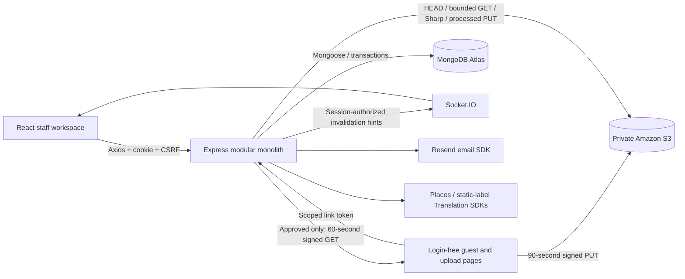

# Make My Marriage — implemented V1 flows

Updated 8 November 2026. This document and the implementation amendments at the top of the PRD/API/system-design documents supersede their older proposed endpoints, workers, two-bucket media designs and placeholder screens.

## Production release additions — 8 November

Password recovery uses the Resend SDK, hashed 15-minute single-use tokens and atomic consumption. Resetting invalidates HTTP/socket sessions; users explicitly log in again. Account/IP throttling reduces abuse. Signup still requires no email verification.

The overview fetches organizer-only finance totals without ledger/audit payloads and shows upcoming functions. Guest-access conflict recovery explicitly discards stale edits. Express serves built React/client deep links in production, with asset caching, integration-aware CSP, JSON API 404s and safe Pino logs. A root React error boundary handles failed page/chunk loading.

See [production deployment guide](Production-Release.md) for Docker, CI/browser verification, production environment examples, HTTPS proxy, IAM role, support/policies and backups. These files do not create a live deployment; provider verification and operator launch steps remain explicit.

## Stack and runtime

One TypeScript repository: Vite/React, React Router, Tailwind/existing CSS tokens, React Hook Form/Zod, TanStack Query and Axios; Express, Mongoose/MongoDB Atlas, express-session/connect-mongo and Socket.IO. Optional integrations use the Resend SDK, AWS SDK for **Amazon S3**, Google Places SDK and Google Cloud Translation SDK. Sharp validates/processes images, qrcode generates QR images, and i18next/react-i18next handles interface language resources.

No new microservice, Redis, BullMQ, queue, scheduled worker, booking, payment gateway or custom livestream infrastructure was introduced. YouTube remains the only livestream integration. AWS hosting is a later deployment step; this change does not deploy anything.



## Accounts, family, wedding and access

1. Signup hashes the password through the existing Mongoose/bcrypt hook. Login regenerates the database-backed session; the browser receives an HttpOnly cookie. Email verification is deliberately not required in V1.
2. The account registers a family, then a wedding. `/app` requires authentication; a missing wedding redirects to setup. Providers can use `/app/provider` without creating a wedding.
3. The wedding creator is the protected Admin. The existing invitation flow grants the exact server-stored Admin/Organizer/Manager/Worker role. Roles are read from wedding membership, not trusted from the session or request body.
4. Managers/Workers do not get budget or guest-directory navigation. The same restrictions apply to REST requests, including unknown budget subpaths.
5. Organizer edits update the common Wedding source of truth. The public website polls for saved changes. The private workspace also receives scoped live invalidation hints. Editing wedding details keeps the original version and typed draft; a concurrent change produces a conflict instead of silently overwriting it.
6. API reads expose explicit safe projections. Finance is `select:false`, public wedding responses have no member IDs, account emails, guest list or financial data.

## Functions, shared work and attention

The previously implemented planning module remains intact: IST functions, overlap checks, family/external departments, starter checklist, assigned staff permissions, shared department progress, three work statuses and organizer on-behalf updates. A department may be entirely family managed. Assigning a provider account is never required.

Manual flags, missed deadlines and stale unfinished work appear under Need Your Attention. No internal flag or work history is automatically published to guests. Scheduled attention emails and invitation reminders are **V2**; only explicit per-family email sends exist in V1.

## Budget and expenses

1. Only Admin/Organizer can read or mutate `/weddings/current/budget`.
2. The optional budget and every monetary amount are **integer INR paise**. The UI accepts rupees and formats Indian currency. An expense can link a wedding department or remain general.
3. Expenses store an agreed cost and notes. Payments record money paid **outside** this app, with date/note/actor. No funds are transferred and guests are not charged.
4. Totals distinguish commitments, paid spending, pending dues, overpayment credit and budget remaining. Overpayment is not silently hidden.
5. Updates send `finance.version`. An atomic Wedding write also checks active organizer membership and Wedding version. One concurrent writer succeeds; stale writers receive 409 and retain their form.
6. Recording a payment requires a UUID idempotency key. Retrying the same payload/key returns its original immutable receipt; reusing a key for different details fails. Replaying a voided payment never recreates it.
7. Void actions require reasons and preserve actor/date/history. An expense with active payments must have those payments voided first.
8. V1 bounds: 200 expenses, 100 payments per expense, 1,000 non-payment audit events and a 12 MB document guard. History is never silently truncated. Move finance into independently indexed collections before exceeding these bounds.

## Email invitations and personal guest access

1. Organizers save an individual/family entry with name, email and Bride/Groom/Both side. There is no guest account, RSVP, admission count or restriction on extra family members.
2. In that family's invitation page, select additional invited functions and save access. The main ceremony is always included. Public function visibility and personal grants are separate controls.
3. A personal URL is `/w/:publicId#invite=<token>`. The bearer token stays out of HTTP paths/query strings and is submitted to Express in JSON. It is derived with Node crypto HMAC; Link lookup fields store a nonce and token hash. Once sent, the protected exact-email snapshot necessarily contains its recipient link; it is never exposed by public/member list APIs. A generic website URL shows only functions explicitly marked public.
4. The personal endpoint returns only that entry's allowed functions and published announcements relevant to them. Invalid/withdrawn links fail closed; the page does not substitute the generic function list. Public ceremony details remain public.
5. Withdraw/re-enable a family's personal link through the same page. This changes live access without changing the frozen HTML of an already submitted email. Removing a function automatically makes its old grant ineffective.
6. Review the React Email preview and explicitly send one invitation through Resend. The existing exact-payload snapshot, provider idempotency key, leases, Failed/Unconfirmed handling and 23-hour safe uncertain-retry window are retained. Submitted means provider acceptance, not delivery.
7. Cross-collection guest writes/send claims use a Mongo transaction with an organizer-membership write check. Removal before the claim blocks it. A send already authorized and claimed cannot be recalled after submission to the provider.
8. There are no campaigns, automatic bulk sends, scheduled reminders, delivery webhooks or WhatsApp sends in this V1.

## Guest updates

`Guest updates` is organizer-only. Create/edit/remove a draft, choose public or selected-function audience, then explicitly publish. Titles are 2–120 characters, messages 3–1,000 characters; up to 100 updates per wedding. Version checks preserve concurrent drafts.

Only published public updates appear on the generic site. Personal links additionally show matching function updates. Text is rendered as text, not injected HTML. Other staff cannot publish announcements.

## Private photo upload and moderation

1. Configure one **private** S3 bucket. Organizers create a QR/link with expiry (1–365 days) and quota (1–1,000 authorization slots); no more than 30 active links per wedding. The token is in `/upload/:publicId#<token>`.
2. The guest opens the link without login, selects up to three photos, and uploads sequentially. Supported input: still JPEG, PNG or WebP, up to 10 MiB per photo. No uploader registration/name is requested.
3. Express validates token, wedding, expiry and quota. A Mongo transaction reserves exactly one slot and creates the upload record. Parallel reservations cannot overspend the quota. Quota counts authorizations, including abandoned attempts; it is not a count of published images.
4. The S3 SDK signs a 90-second PUT to a private staging key. Axios sends the file directly to S3 with only signed headers, without application cookies or CSRF tokens. A failed PUT can renew the same upload ID without consuming another slot.
5. Completion claims a processing lease, reads metadata/size, downloads a bounded range and passes bytes to Sharp. Actual format must match the supported MIME; animation and images above 40 million input pixels are rejected. Sharp auto-orients, resizes inside 3,200 × 3,200, re-encodes WebP and drops original metadata.
6. Each processing attempt writes a different server-owned review key. A delayed older attempt cannot overwrite a newer moderated photo. Processing is capped at two concurrent verifications on the V1 server, with explicit retry rather than an unbounded in-memory queue; at most eight attempts per reserved upload.
7. The processed image remains private and Pending. Completion rechecks the grant atomically, so revocation races safely. A repeated successful completion returns Pending without creating another image.
8. Only organizers see private previews and approve/reject. Staff may see the approved gallery; Worker/Manager cannot read private review tabs or grant links. Moderation checks photo version and active organizer membership in a transaction.
9. Public gallery/content/download APIs return **approved** photos only. A content request rechecks approval then redirects to a 60-second signed private-bucket GET. Unpublishing stops new content grants. Already issued URLs may work until expiry, and downloaded copies cannot be recalled.
10. Rejection records the decision first and attempts SDK deletion. Cleanup failures remain marked; they are not reported as successful storage deletion. Abandoned/rejected staging media is handled by the explicit maintenance command below. Approved images are never deleted by that command.

## Registered service directory and reviews

- Any signed-in account can publish one provider profile, with category, contact, user-entered address/coordinates, service radius, availability text and HTTPS portfolio links. Profile edits require the previous version. There are no made-up listings or reviews.
- The public directory supports text/category filters, newest/rating sort, pagination and MongoDB 2dsphere distance filtering. It shows providers whose stated service radius covers the search point; this does not promise availability or confirm hiring.
- A profile can be added once to wedding departments. Contact details are copied; the provider gets **no membership or access** automatically. Confirm hiring directly outside the app, and use People & Access separately if they need staff access.
- Only an organizer of a completed department linked to that provider may post one review per service. The provider cannot review their own service. Only the original author may edit with the expected version while still eligible. Ratings use visible reviews; these are not verified bookings/purchases.
- Platform moderation is an explicit server-configured allowlist of User ObjectIds. A wedding Admin is not a platform moderator. Moderators may hide/unhide profiles and reviews with a reason. Profile owners cannot clear moderation fields.

## Google Places and Hindi interface labels

Place search uses the official Google Places SDK from Express. Selection saves only `googlePlaceId`, which is added to Google Maps directions; the app keeps venue/address/city and GPS coordinates entered by the user. Search results are transient and include Google Maps attribution. Google Places text/coordinate caching is restricted; this V1 does not turn search results into a permanently stored address database. This also avoids retaining stale vendor-location data from Google. Add your public privacy/terms documents before enabling Google integrations on a public deployment.

The Hindi toggle uses i18next and the official Cloud Translation SDK. Express translates a fixed allowlist of shared interface/navigation labels and caches it in Mongo for 24 hours. Other descriptive copy and dynamic content remain authored as before. Names, phone numbers, URLs, guest records, notes and finance are not sent for translation. Failure keeps English available. This is a translated common interface, not a separately authored full Hindi website.

## Socket.IO and concurrency

- Socket.IO shares express-session/connect-mongo. The server verifies the user and wedding membership before joining server-assigned team/organizer rooms. Clients cannot subscribe to an arbitrary wedding ID.
- Successful REST writes emit only a small invalidation resource hint after the response/commit. Finance and guest hints go to organizer rooms, without amounts, guest names, emails, bearer links or notes.
- Team removal rechecks connected members immediately; logout/session regeneration disconnect the corresponding session. Active sockets also reload persisted sessions/membership every 15 seconds.
- On reconnect the frontend invalidates cached queries. Server-initiated removal clears protected cached values. Focused-page polling remains a recovery fallback. Open wedding and planning forms keep their original version/draft for conflict detection.
- V1 is a single Express instance with per-process rate limits and a two-image processing cap. More replicas require a Socket.IO adapter, shared rate limiting, capacity control, and load-balancer/cookie configuration. Mongo transactions require Atlas or another replica set, not standalone MongoDB.

## Keys and manual configuration

Copy the newly documented integration keys from `server/.env.example` into the existing gitignored `server/.env`. Do not replace your real file or put secrets in `VITE_*` variables.

| Setting | Needed for |
|---|---|
| `MONGODB_URI`, `SESSION_SECRET`, `APP_ORIGIN` | Existing required app/session setup |
| `LINK_SECRET` | Stable 32+ character secret for personal/QR links; set before sharing links |
| `RESEND_API_KEY`, `RESEND_FROM` | Explicit per-family sends; use a verified sending domain |
| `AWS_REGION`, `S3_BUCKET`; `AWS_PROFILE` for local development | Private Amazon S3 storage using the SDK credential chain |
| `GOOGLE_PLACES_API_KEY` | Optional Places search, with billing/API enabled and key restrictions |
| `GOOGLE_TRANSLATION_API_KEY` | Optional shared-interface Hindi translation |
| `PLATFORM_MODERATOR_USER_IDS` | Optional platform content moderators; no implicit wedding-role grant |

Keep `LINK_SECRET` stable. Rotating it invalidates existing guest/QR links; save family access again to reissue personal links and create new QR grants. Old emails are not rewritten. The fallback is SESSION_SECRET if LINK_SECRET is empty; use a separate stable secret before production.

Amazon S3 setup:

1. Create one private general-purpose bucket in the chosen AWS Region. Keep Block Public Access enabled, ACLs disabled (Bucket owner enforced), and default SSE-S3 encryption. Approved photos also stay private; the app issues short-lived GET URLs only after authorization/moderation checks.
2. Set `AWS_REGION` and `S3_BUCKET` in `server/.env`. For local development, set `AWS_PROFILE` to a configured AWS CLI profile; credentials stay outside the repository. For AWS deployment omit `AWS_PROFILE` and attach a bucket-scoped IAM role to the backend. The SDK resolves credentials without custom credential-management code. The former R2 environment variables are no longer used.
3. Limit the identity to `s3:GetObject`, `s3:PutObject`, and `s3:DeleteObject` on this bucket's `staging/*` and `review/*` objects. The application does not require bucket listing, ACL changes, public access, or other buckets. See [the scoped policy](aws/s3-iam-policy.json).
4. Configure bucket CORS for the actual frontend origin using [the local development CORS configuration](aws/s3-cors.json). Add the production HTTPS origin when deploying. CORS is not an authorization policy.
5. An optional lifecycle rule deleting only `staging/` after one day can be added after agreeing on retention. Do not expire `review/` or the entire bucket. No lifecycle deletion rule is enabled by the application.
6. Run `npm run media:cleanup --workspace server` explicitly to retry cleanup and reject uploads abandoned over 24 hours. It processes up to 200 records per run and prints counts only. It never deletes the processed key of a Pending/Approved image. Repeat if there is a backlog. No background worker is silently started.
7. Turn off Resend link/open tracking for sensitive bearer links where applicable; links remain intentionally shareable, not identity-bound guest authentication.

See [AWS S3 setup and verification](AWS-S3-Setup.md) for the bucket details, credential setup and smoke test.

Optional integrations fail with clear unavailable states when keys are missing; account, wedding, planning, budget and guest record flows still work.

## Local checks and deployment boundary

```sh
npm install
npm run check
npm run dev
```

Vite listens on port 3000, Express on 3001. Vite proxies `/api` and `/socket.io` (including WebSocket upgrades). `npm start` runs compiled Express; production serves both React and API. Reverse proxy/TLS, backups, retention policy, monitoring, domain/provider verification and real-cloud smoke tests remain deployment work. Set production APP_ORIGIN, secure cookies and explicit trusted proxy CIDRs correctly; do not use an unrestricted proxy trust setting.

Tests use disposable MongoDB, including a replica set for cross-collection transactions; Resend is injected/stubbed and S3 operations use an isolated fake HTTP object store. They never send real invitations or write to Atlas. Google missing-key behavior and cache boundaries are tested; paid Google/S3/Resend interoperability still needs a smoke test after credentials and service settings are supplied.

Official references: [S3 presigned URLs](https://docs.aws.amazon.com/AmazonS3/latest/userguide/using-presigned-url.html), [S3 CORS](https://docs.aws.amazon.com/AmazonS3/latest/userguide/ManageCorsUsing.html), [Sharp constructor limits](https://sharp.pixelplumbing.com/api-constructor/), [Places policies](https://developers.google.com/maps/documentation/places/web-service/policies), [Maps service terms](https://cloud.google.com/maps-platform/terms/maps-service-terms), [Socket.IO sessions](https://socket.io/how-to/use-with-express-session).
