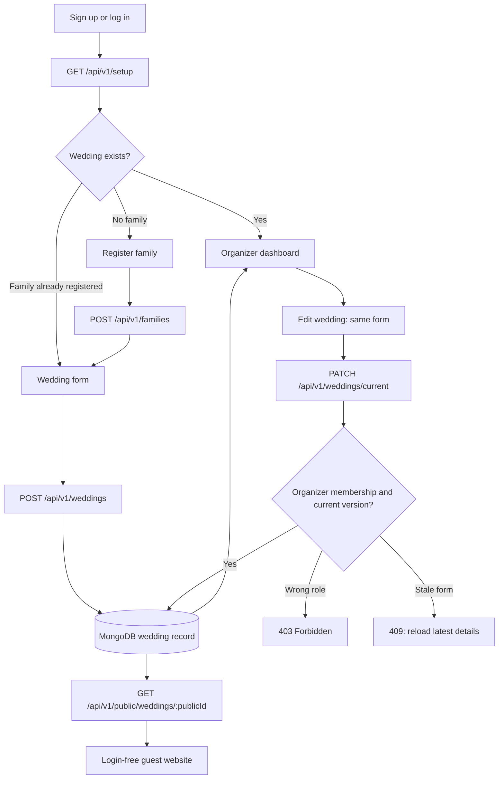

# Account → family → wedding

The setup UI follows the [Stitch onboarding screen](https://stitch.withgoogle.com/projects/880870202033707852) `d9719a1147394ec6841e8a7cf403acdb` (Your wedding, your beginning — Onboarding). The app uses empty fields rather than sample wedding identities.

## API behavior

| Endpoint | Access | Result |
| --- | --- | --- |
| `GET /setup` | Signed-in account | Its family, wedding and wedding role; missing setup values are null |
| `POST /families` | Signed-in account + CSRF | Creates that account's family; the server sets the owner |
| `POST /weddings` | Family owner + CSRF | Creates one wedding, assigning the creator protected Admin membership |
| `GET /dashboard` | Wedding member | Returns stored wedding and family details; without a wedding returns 409 `WEDDING_REQUIRED` and `redirectTo: /app/setup` |
| `PATCH /weddings/current` | Organizer member + CSRF | Validates details and the version, updates the existing record, preserves the guest URL |
| `GET /public/weddings/:publicId` | Public | Explicit guest-safe ceremony/contact fields only |

All endpoints above are prefixed `/api/v1`.

An API returns a JSON redirect instruction rather than an HTTP redirect to an HTML page. The React route guard performs navigation to setup. Anonymous private requests receive 401 and the UI goes to login.

## Stored data

- `User`: existing account and password hash.
- `Family`: unique owner, family name and bride/groom/both side.
- `Wedding`: unique family and creator, unique public ID, embedded user/role memberships, couple names, date and times, venue/address/city, optional coordinates, guest-facing role/phone, welcome note, YouTube link, timestamps and version.

One account belongs to one wedding in v1. Required uniqueness indexes are built before HTTP startup. Ownership and roles come from the session and database, never from a submitted form. The browser never connects directly to MongoDB.

## Keeping the two views in sync

The same wedding record powers both APIs. A successful edit immediately refreshes the organizer's cached data. Already-open guest pages re-fetch every thirty seconds and on focus. No localStorage draft or sample wedding is used. Edit forms pause automatic refresh so another person's update does not erase typed input; version checks reject stale saves and let the organizer reload deliberately.

Public responses exclude family ownership, account email, member IDs/roles, password hashes and financial data. The guest contact is explicitly marked public in the setup form.

The original Stitch workspace UI is retained after wedding creation: Overview, Functions, Teams & Services, Budget & Expenses, Guests & Invites, Find Services, Photos, Guest Website, Wedding Settings and People & Access. All these routes use the same wedding guard; none can bypass setup. Budget navigation/screens are Admin/Organizer-only. Ceremony details and the guest preview use the stored wedding record, and Wedding Settings reuses the existing edit form.

Nearby service categories open Google Maps search around the saved wedding address or coordinates. They are category suggestions, not seeded vendor profiles. Expense storage, photo uploads and additional planning sections remain coming soon. Guest email invitations and team invitation links are now implemented; see README and API-design amendments. Team invitees join their existing wedding directly after login/signup and acceptance. Admins/Organizers can access private planning; Managers/Workers cannot view Budget or guest records.
